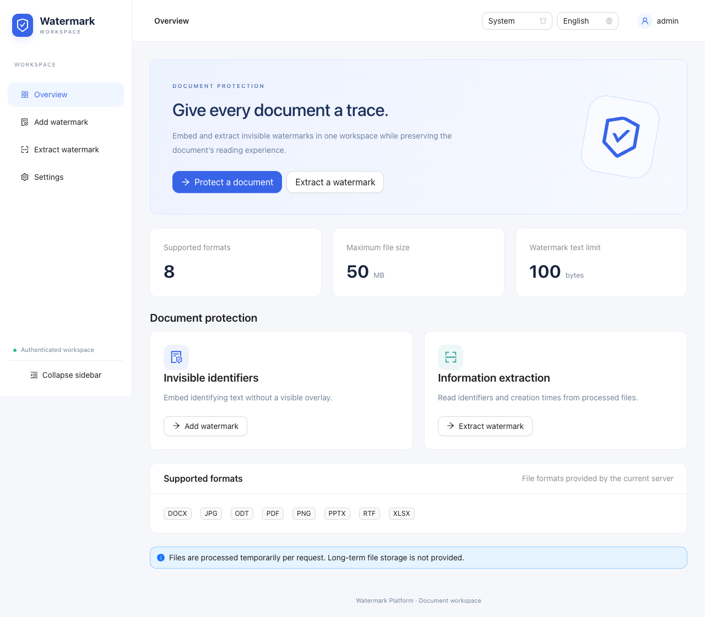
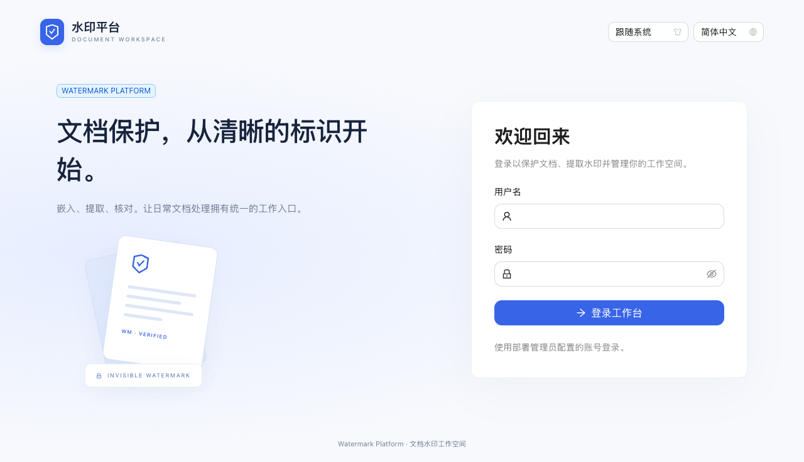
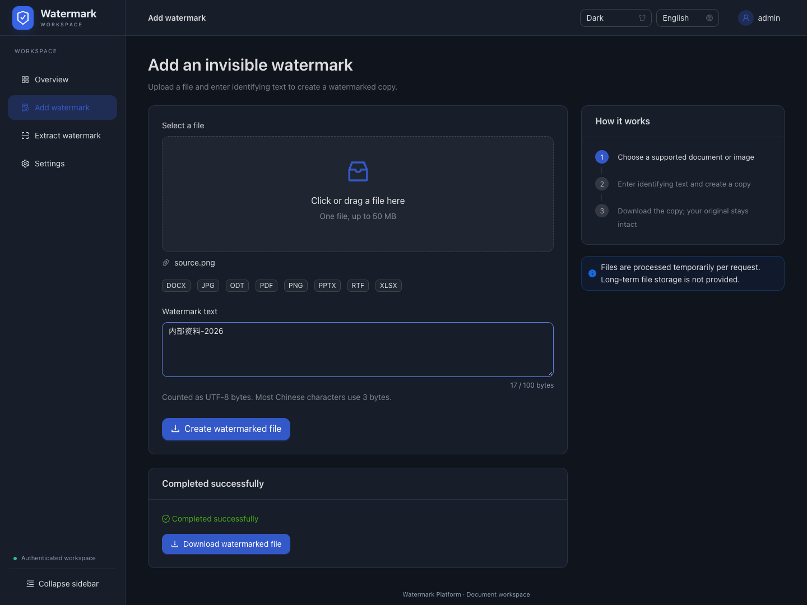
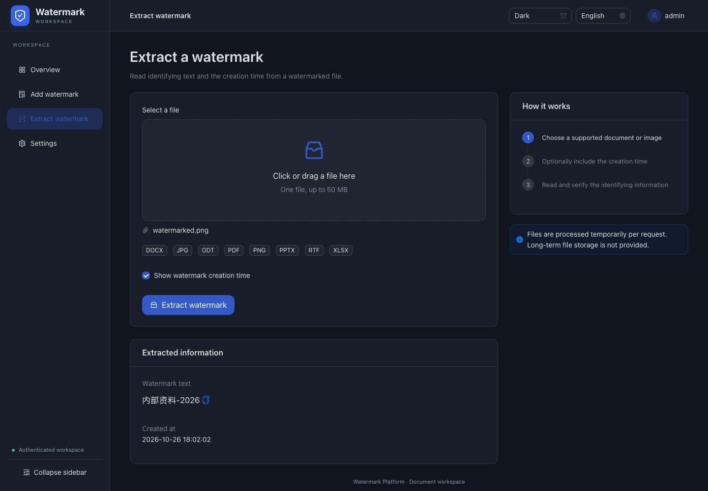

# 文档水印平台

一个安全、高效的隐形文档水印解决方案，可为各类文档添加完全不可见的数字水印，同时支持水印提取和验证。基于Go语言开发，支持web和cli两种方式使用，水印采用隐写技术，确保水印完全隐形且不影响原始文档的阅读体验和视觉效果。



## 更新时间线
- 2025.06.08
  1. 🌟在提取水印时，增加了‘显示水印添加时间’的功能；
  2. 解决了一个前端复选框的bug，该bug会导致选择‘显示水印添加时间’无法生效。
  3. 解决了一个后端bug，该bug会导致jpg无法加水印，以及excel加水印后无法打开。

## 平台界面与登录

前端使用 React + TypeScript + Ant Design，提供工作台、添加水印、提取水印和设置页面，支持响应式侧边导航、浅色/深色/跟随系统主题及简体中文/English。显示偏好保存在当前浏览器；不保存密码或登录令牌到 localStorage。工作台不存储处理历史或长期文件。



### 构建与启动（平台版）

需要 Go 1.24.4+、Node.js 20.19+ 或 22.12+、npm。首次启动前必须构建前端：

```bash
cd web/frontend
npm ci
npm run build
cd ../..
go build -o server ./cmd/server
export WATERMARK_ADMIN_USER=admin
# 请设置自己的密码，至少 12 字节；下面交互输入不会写入命令历史。
read -s WATERMARK_ADMIN_PASSWORD
export WATERMARK_ADMIN_PASSWORD
./server
```

从仓库根目录启动并访问 http://localhost:8080。服务提供本地 `web/dist` 资源，不依赖浏览器 CDN。每次修改前端后重新构建。`web/dist` 不提交到 Git，部署时需与二进制一起复制；无需运行 Node 服务。

| 环境变量 | 说明 |
| --- | --- |
| `WATERMARK_ADMIN_USER` | 必填，单管理员用户名 |
| `WATERMARK_ADMIN_PASSWORD` | 必填，至少 12 字节；不提供默认密码 |
| `WATERMARK_COOKIE_SECURE` | HTTPS 部署设 `true`；本地 HTTP 默认 `false` |
| `PORT` | 默认 `8080` |

配置缺失时登录返回 503，页面显示配置说明。`.env.example` 仅作变量参考，服务不会自动读取 `.env`。生产环境应通过 HTTPS 提供平台，并配置安全 Cookie。服务默认不信任代理提供的客户端 IP；代理部署需按实际网络配置可信代理后再按客户端 IP 限流。

会话使用随机令牌、HttpOnly / SameSite=Strict Cookie，最长 8 小时，退出即撤销，服务重启后失效。当前为单实例内存会话，不支持多副本共享登录。账号密码修改后需重启服务。不提供注册、密码找回、角色或用户管理。

### 开发与验证

```bash
# 终端 1：配置上述账号变量后，在仓库根目录运行
 go run ./cmd/server
# 终端 2：开发服务器（代理 /api 至本地 :8080）
 cd web/frontend
 npm run dev

# 仓库根目录运行 Go 检查
 go test -race ./...
# 前端目录运行
 npm run build
 npx playwright install chromium
 npm run test:e2e
```

E2E 使用专用本地 :18080 服务与测试账号，执行前需已构建前端，并保证端口空闲。测试覆盖登录、访问控制、文件往返、偏好保存和移动端导航。开发代理以 Vite 默认转发原始 Host 的方式保持同源检查。

### API 登录迁移（兼容性变化）

水印 API 路径、参数及成功响应不变，但现在必须先登录并携带会话 Cookie，匿名请求返回 401。CLI 使用不变。浏览器跨站写请求返回 403。登录与文件操作共享每 IP 每分钟 10 次限制，静态资源、会话探测、格式查询和退出不计入额度。

```bash
# 将凭据 JSON 写入本地受限权限文件，不将真实密码放进版本库。
curl -c cookies.txt -H 'Content-Type: application/json' \
  --data-binary @credentials.json http://localhost:8080/api/auth/login
curl -b cookies.txt http://localhost:8080/api/auth/session
curl -b cookies.txt -F 'file=@文档.pdf' -F 'watermark=内部资料' \
  http://localhost:8080/api/add-watermark -o watermarked.pdf
curl -b cookies.txt -F 'file=@watermarked.pdf' \
  'http://localhost:8080/api/extract-watermark?show_timestamp=true'
curl -b cookies.txt -X POST http://localhost:8080/api/auth/logout
```

`credentials.json` 格式为 `{"username":"你的账号","password":"你的密码"}`。Cookie jar 包含会话凭据，退出后删除本地临时文件。新增接口：`POST /api/auth/login`、`GET /api/auth/session`、`POST /api/auth/logout`。当前单文件最大 50 MB，水印文本最大 **100 个 UTF-8 字节**（并非 100 个中文字符）。

## 功能界面

以下为当前 Ant Design 平台的实际操作截图。

### 添加隐水印



### 提取隐水印



## 主要特性

- **完全隐蔽**：水印完全隐形，对文档内容和外观零影响，肉眼无法识别
- **安全加密**：使用强加密算法确保水印信息安全不被篡改
- **防篡改设计**：独特校验机制确保水印不被非法修改，增强安全性
- **多格式支持**：兼容多种常用文件格式（PDF、DOCX、XLSX、PPTX、JPG、PNG等）
- **简洁界面**：直观易用的Web界面，操作简单快捷
- **API支持**：提供完整REST API，便于集成到现有系统
- **高性能处理**：优化的处理流程，快速处理各类文档，支持并发请求

## 支持的文件格式

| 文件类型 | 水印添加 | 水印提取  | 备注 |
|---------|:-------:|:-------:|------|
| PDF     | ✅      | ✅      | 元数据隐写技术，文档外观无变化 |
| DOCX    | ✅      | ✅      | 在文档属性和内容中添加隐藏标记 |
| XLSX    | ✅      | ✅      | 在电子表格内部XML中添加加密标记 |
| PPTX    | ✅      | ✅      | 在幻灯片XML中添加不可见注释 |
| JPG     | ✅      | ✅      | 使用EXIF注释和加密方式添加水印 |
| PNG     | ✅      | ✅      | 使用文本块添加隐藏水印 |
| RTF     | ✅      | ✅      | 使用特殊字段隐藏水印信息 |
| ODT     | ✅      | ✅      | 在文档XML结构中添加隐藏标记 |

## 使用指南

### Web界面使用

1. 访问 http://localhost:8080，使用配置的管理员账号登录
2. 从侧边栏选择"添加隐水印"或"提取隐水印"功能
3. 上传文件并输入隐水印文本（添加水印时）
4. 等待处理完成后下载文件或查看提取结果

### 命令行(CLI)使用

除了Web界面外，本工具还提供命令行界面(CLI)，方便在脚本中使用或批处理文件。

#### 构建CLI工具

```bash
# 构建CLI工具
go build -o cli ./cmd/cli
```

构建完成后，CLI工具位于 `./cli`。

#### CLI命令

1. 添加水印

```bash
./cli add [输入文件] [输出文件] [水印文本]

# 示例
./cli add 文档.pdf 带水印.pdf "机密文件-请勿外传"
```

2. 提取水印

```bash
./cli extract [输入文件]

# 示例
./cli extract 带水印.pdf
```

3. 查看支持的文件类型

```bash
./cli types
```

### API接口使用

以下请求均需按前述迁移说明携带 `-b cookies.txt`，编程示例同样需要 Cookie jar 并预先登录。

#### 添加隐水印

```http
POST /api/add-watermark
Content-Type: multipart/form-data

参数:
- file: 文件数据
- watermark: 隐水印文本
```

示例请求：

```bash
curl -b cookies.txt -X POST -F "file=@文档.pdf" -F "watermark=机密文件" \
     http://localhost:8080/api/add-watermark -o 带水印文档.pdf
```

#### 提取隐水印

```http
POST /api/extract-watermark
Content-Type: multipart/form-data

参数:
- file: 文件数据
```

示例请求：

```bash
curl -b cookies.txt -X POST -F "file=@带水印文档.pdf" \
     http://localhost:8080/api/extract-watermark
```

#### 获取支持的文件类型

```http
GET /api/supported-types
```

示例响应：

```json
{
  "types": ["pdf", "docx", "xlsx", "pptx", "jpg", "png", "rtf", "odt"]
}
```

### 编程示例

以下是通过Go代码使用该工具的简单示例：

```go
package main

import (
	"bytes"
	"fmt"
	"encoding/json"
	"net/http/cookiejar"
	"io"
	"mime/multipart"
	"net/http"
	"os"
	"path/filepath"
)

func main() {
	// 添加隐水印示例
	filePath := "example.pdf"
	watermarkText := "机密文档-请勿外传"
	
	err := addWatermark(filePath, watermarkText)
	if err != nil {
		fmt.Printf("添加隐水印失败: %v\n", err)
		return
	}
	
	// 提取隐水印示例
	watermarkedFile := "example_watermarked.pdf"
	text, err := extractWatermark(watermarkedFile)
	if err != nil {
		fmt.Printf("提取隐水印失败: %v\n", err)
		return
	}
	
	fmt.Printf("提取的隐水印内容: %s\n", text)
}

// 添加隐水印
func addWatermark(filePath, watermarkText string) error {
	// 创建multipart表单
	var buf bytes.Buffer
	writer := multipart.NewWriter(&buf)
	
	// 添加文件
	file, err := os.Open(filePath)
	if err != nil {
		return err
	}
	defer file.Close()
	
	part, err := writer.CreateFormFile("file", filepath.Base(filePath))
	if err != nil {
		return err
	}
	_, err = io.Copy(part, file)
	if err != nil {
		return err
	}
	
	// 添加水印文本
	err = writer.WriteField("watermark", watermarkText)
	if err != nil {
		return err
	}
	
	writer.Close()
	
	// 发送请求
	resp, err := httpClient.Post("http://localhost:8080/api/add-watermark", writer.FormDataContentType(), &buf)
	if err != nil {
		return err
	}
	defer resp.Body.Close()
	
	// 检查响应
	if resp.StatusCode != http.StatusOK {
		return fmt.Errorf("服务器返回错误: %s", resp.Status)
	}
	
	// 保存结果
	output, err := os.Create(filePath[:len(filePath)-4] + "_watermarked" + filepath.Ext(filePath))
	if err != nil {
		return err
	}
	defer output.Close()
	
	_, err = io.Copy(output, resp.Body)
	return err
}

// 提取隐水印
func extractWatermark(filePath string) (string, error) {
	// 创建multipart表单
	var buf bytes.Buffer
	writer := multipart.NewWriter(&buf)
	
	// 添加文件
	file, err := os.Open(filePath)
	if err != nil {
		return "", err
	}
	defer file.Close()
	
	part, err := writer.CreateFormFile("file", filepath.Base(filePath))
	if err != nil {
		return "", err
	}
	_, err = io.Copy(part, file)
	if err != nil {
		return "", err
	}
	
	writer.Close()
	
	// 发送请求
	resp, err := httpClient.Post("http://localhost:8080/api/extract-watermark", writer.FormDataContentType(), &buf)
	if err != nil {
		return "", err
	}
	defer resp.Body.Close()
	
	// 检查响应
	if resp.StatusCode != http.StatusOK {
		return "", fmt.Errorf("服务器返回错误: %s", resp.Status)
	}
	
	// 读取结果
	var result struct {
		Watermark string `json:"watermark"`
		Error     string `json:"error"`
	}
	
	body, err := io.ReadAll(resp.Body)
	if err != nil {
		return "", err
	}
	
	return string(body), nil
}
```

## 隐水印技术原理

本工具采用多种隐写技术实现不可见水印：

1. **元数据嵌入**：在文件元数据中嵌入加密水印信息
2. **内容隐写**：在文档内容的不可见部分嵌入编码信息
3. **结构隐藏**：利用文件格式结构特性隐藏水印数据
4. **加密保护**：使用AES-GCM等高强度加密算法保护水印内容
5. **校验机制**：添加校验和和时间戳确保水印完整性

## 安全特性

该工具采用多层次安全设计，确保水印信息的安全性：

1. **数据加密**：所有水印内容使用AES-256算法加密存储
2. **密钥管理**：系统使用安全的密钥生成和管理机制
3. **完整性验证**：使用校验和机制验证水印完整性，防止篡改
4. **时间戳**：每个水印都包含时间戳信息，可用于追踪溯源
5. **抗提取设计**：即使知道水印存在，没有正确工具和密钥也无法提取
6. **错误处理**：安全的错误处理机制，不会泄露敏感信息

为提高安全性，建议：
- 定期更换系统密钥
- 限制API访问权限
- 启用HTTPS加密传输
- 记录所有水印操作日志

## 注意事项

1. 虽然水印完全隐形，但在特定情况下可能被专业工具检测到
2. 水印安全性依赖于密钥的保密性，请妥善保管系统密钥
3. 不同文件格式的水印实现方式不同，安全级别可能有差异
4. 处理大型文件时可能需要调整服务器配置，增加超时时间

## 未来计划

- [ ] 支持更多文件格式（包括音频和视频格式）
- [ ] 添加批量处理功能
- [ ] 实现水印模板和权限管理
- [ ] 提供更高级的水印策略（如动态水印、分层水印）
- [ ] 开发桌面客户端版本

## 许可证

本项目采用 MIT 许可证 - 详见 LICENSE 文件 
