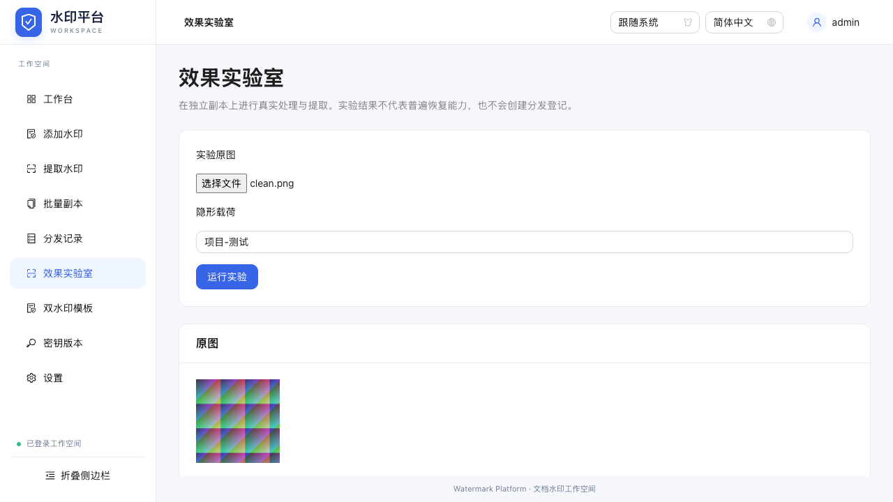
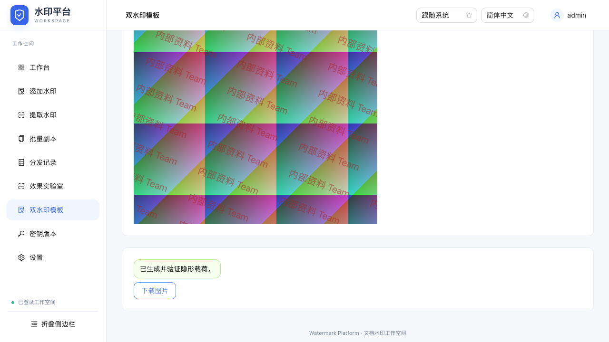
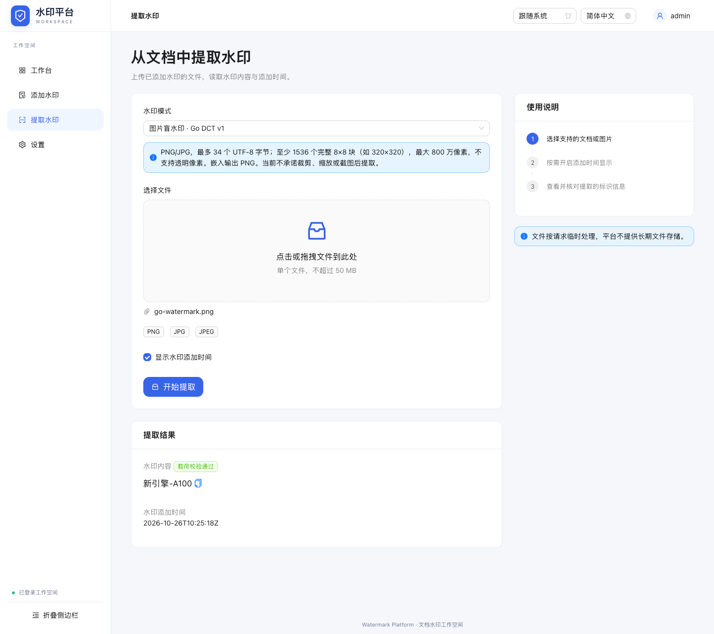
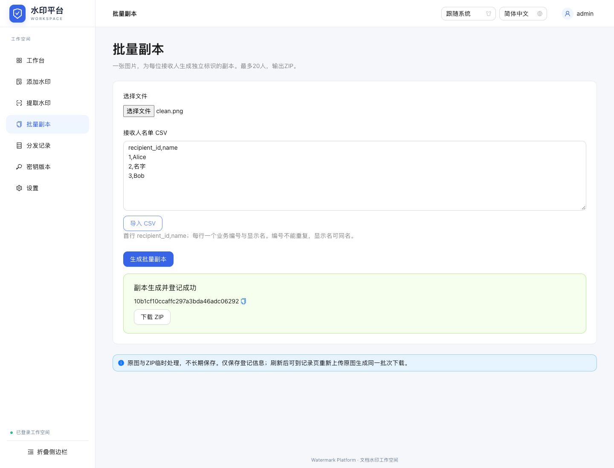
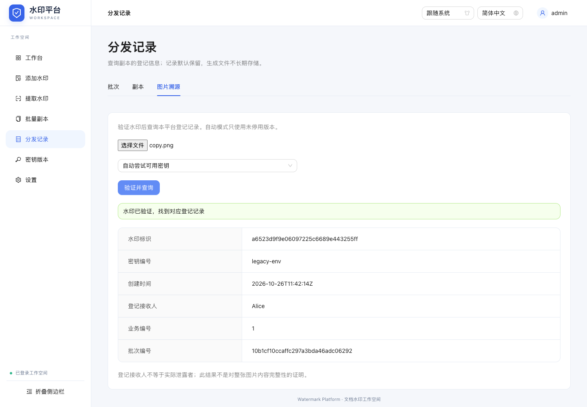
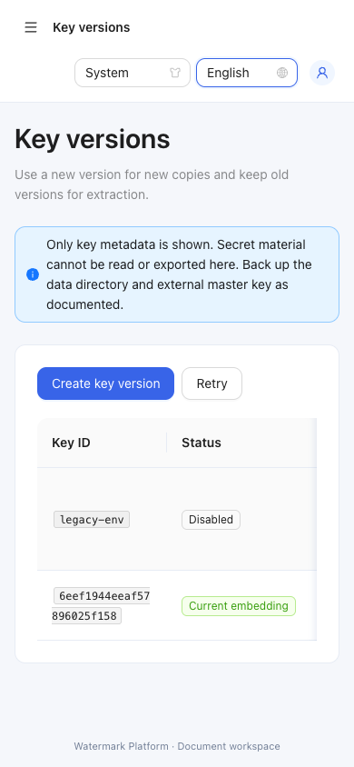

# 文档水印平台

基于 Go 的文档标记与图片盲水印平台，提供 Web 和 CLI。兼容模式处理 PDF、Office 等文件；自研 Go DCT v1 将带校验的短文本写入图片内容，可在明确的测试条件下经过重新编码后提取。不同模式的隐蔽性、抗处理和安全边界不同。


## 变更记录

新增能力、Bug 修复及其他变更按日期记录在 [CHANGELOG.md](CHANGELOG.md)，包含迁入的历史更新时间线。

## 效果实验室、双水印与报告

新增 **效果实验室** 和 **双水印模板** 入口，沿用登录、主题与中英偏好，不新增水印算法库或Go依赖。既有Go DCT v1协议、分发登记及密钥轮换保持兼容。

### 效果实验室



上传PNG/JPG原图和最多34个UTF-8字节的隐形载荷，使用当前管理密钥（未启用管理库则使用 `WATERMARK_BLIND_KEY`）。服务端从同一盲水印基线独立生成以下8项实验及2个负例，不创建真实接收人登记：

- 原样PNG；JPEG质量95、85、75。
- 最近邻缩放为75%、50%；中心保留90%宽高裁剪；顺时针旋转90度。
- 原始输入、随机错误密钥两个负例。如果原始输入已经带有有效水印，会明确标记负例异常。

每行展示实际输出尺寸、恢复结果、错误码、耗时及同尺寸PSNR；完整文本一致且验证通过才算恢复。PSNR参考原始解码RGB，不同尺寸或完全相同（无限值）显示“—”。图像预览为最多640px的JPEG缩略图，恢复判断使用完整处理输出。可下载JSON/HTML实验报告（不包含缩略图数据），报告包含源文件摘要及每项完整输出摘要。

**执行裁剪、缩放或旋转测试不等于算法支持恢复**。失败如实展示，单图结果不代表任意图片；没有模拟真实拍屏或新增几何恢复算法。原图不变，不串联多个变换。每次实验最多90秒，在处理步骤间响应取消；取消后当前不可中断编解码步骤结束才释放服务端处理槽。

### 双水印模板



1. 选择原图，输入可见文字和独立的隐形载荷。
2. 配置单处/平铺、位置、12～96字号、颜色、0.05～1不透明度与平铺角度，生成预览。
3. 核对可见文字，生成并下载PNG；服务端嵌入隐形载荷后实际提取校验，失败不交付成功下载。

可见文字支持中文/英文，最多80字符且单行。使用当前设备系统字体，有缺字或文字过宽时提示调整；系统字体会影响外观，必须检查预览。**同一份预览PNG提交给Go处理**，服务端不另行渲染字体；下载图额外包含盲水印像素变化。可见层在隐形层之前生成。

内置角落/斜向平铺样式；命名自定义模板最多20个，只在当前浏览器保存样式，不保存图片或本次文字，不跨设备同步。浏览器存储损坏/禁用/已满会提示，保存有效新模板可覆盖损坏配置。输入或样式变化使旧预览/下载失效；离开新页面取消在途请求并释放临时结果，重新进入需要重新选图。

输入沿用PNG/JPG、50MiB、800万像素、非透明与Go v1容量限制；浏览器先检查编码头尺寸再解码。不是多人多图批次模板，不改变旧批次的重生成结果。

### 验证报告

Go单图提取和分发记录的图片溯源页面都有 **验证并生成报告**，对当前所选文件独立验证。报告包含实际上传文件SHA-256、尺寸、服务端观察时间/耗时、算法、状态，以及通过验证后的载荷/水印时间、已知密钥编号和可选登记信息。

- `registered`：载荷通过验证且匹配本平台登记。
- `unregistered`：载荷通过验证，但没有对应登记。
- `not_found`：本次未检出有效水印，不能断言图中绝无水印。
- `invalid`：载荷验证失败或图片容量不足。

配置缺失、停用密钥、网络/服务异常等明确报错，不伪造“未检出”报告；单环境模式不虚构管理版本编号。JSON保留字段名，HTML自包含、无脚本/外链，可离线阅读或用浏览器打印为PDF。所有用户文字均转义。报告由用户下载保管，服务端不新增长期实验/图片/报告库。报告不是数字签章、第三方鉴定、可信时间认证或实际泄露者认定，也不证明整图内容完整。

### 新增工作流 API

均为受认证、同源保护和限流的multipart POST，复用全局最多两个处理槽。使用现有登录Cookie：

| 接口 | 字段 | 响应 |
| --- | --- | --- |
| `/api/workbench/lab` | `file`原图、`watermark` | schema_version=1的实验JSON，含缩略预览 |
| `/api/workbench/dual` | `file`已渲染可见层PNG、`watermark`隐形载荷 | 实际校验后的PNG |
| `/api/workbench/verify` | `file`、可选`key_id` | schema_version=1的验证JSON；真实阴性/校验失败为200内状态，输入/配置/权限异常仍为非200 |

详细契约与验证见 [设计](docs/feature/watermark-workbench/design.md) 和 [验收记录](docs/feature/watermark-workbench/verification.md)。

## 批量副本、登记溯源与密钥版本

平台新增三个入口：**批量副本、分发记录、密钥版本**。按名单为同一张图片生成不同标识的副本，验证图片后查询登记信息；“登记接收人”不等于实际泄露者。平台只生成和打包文件，不自动向接收人发消息或邮件。

### 启用持久功能

```bash
# 先按下文构建前端与 ./cli，保留已有管理员配置。
export WATERMARK_DATA_DIR="$(pwd)/.watermark-data"
# 仅首次生成！请通过私密环境配置保存，后续启动必须使用同一个主密钥。
export WATERMARK_DATA_KEY="$(./cli blind-keygen)"
./server
```

`WATERMARK_DATA_KEY` 是32字节随机主密钥的64位hex表示，必须与旧 `WATERMARK_BLIND_KEY` 不同。不要在每次启动脚本里重新生成，也不要把真实值提交 Git。生产配置和备份应放在受限权限位置；服务不会自动读取 `.env`。

| 配置/状态 | 行为 |
| --- | --- |
| DATA_DIR 与 DATA_KEY 均不配置 | 旧单文件功能照常，三个新增入口提示配置未启用 |
| 只配置其中一个、主密钥错误或状态损坏 | 启动明确失败，不静默清空或重建数据 |
| 首次启用且已有有效 BLIND_KEY | 一次性导入为 `legacy-env` 当前版本，旧 v1 水印继续可验证 |
| 首次启用但无 BLIND_KEY | 安全生成初始当前版本，材料只保存于加密密钥库 |
| 已初始化后保留旧 BLIND_KEY | 必须与迁入值相同；后续轮换通过版本管理完成，不靠改旧环境变量 |

持久功能使用标准库，单实例写入，私有目录0700、文件0600；密钥字段经 AES-GCM 独立加密，与记录元数据共同原子保存于v2快照，由主密钥派生的 HMAC 保护整体完整性，两个用途派生不同密钥。使用 OS 文件锁，第二个写进程拒绝启动。本轮持久模式支持 macOS/Linux 等支持 flock 的 Unix；不支持的平台明确拒绝启用，未配置持久模式的原功能仍可运行。

### 名单与批次

一批一张符合 Go DCT v1 限制的图片，最多20名接收人。页面可直接录入或导入不超过16KB的 UTF-8 CSV（允许BOM）：

```csv
recipient_id,name
001,Alice
002,张三
003,张三
```

编号按原值区分、在本批次内不能重复；姓名允许同名。每份副本嵌入独立32位随机标识，ZIP内用标识命名PNG，另附UTF-8 `manifest.csv` 对应名单。导出对可能触发电子表格公式的字段做文本转义。原图作为不可变输入，不在上一副本上累积嵌入。

批次提交使用 `Idempotency-Key`（16–128字符，页面自动生成）：相同键/相同输入沿用原批次和标识；同键不同输入409；同批次并行请求409。整个ZIP生成并提交登记后才交付，不返回部分成功包。生成包最多128MiB，与单图共用两个处理槽；任务繁忙429。记录总量最多10000批，实际还受64MiB状态文件限制，满后明确拒绝，不自动删除旧记录。

**不长期保存原图、副本或ZIP**。下载响应结束即清理服务端临时文件，网页刷新后不提供永久下载链接。正常 SIGTERM/中断会优雅关闭并清理；异常强杀可能留下私有 runtime 目录，下一次用正确配置启动并取得独占锁后仅清理该临时目录，不删除登记或密钥文件。记录页可重新上传原始图片（SHA-256必须相同），使用原批次标识、时间与密钥重新生成ZIP，不新增分发记录。密钥停用后不能重生成，需管理员显式恢复该版本。重生成失败不撤销先前已成功生成副本的登记。

生成中断会在重启时标为失败/`interrupted`，可核对输入重试。磁盘写入失败或持久状态不确定时服务明确拒绝继续操作，需检查权限、磁盘与备份后重启，不能以删除数据目录代替修复。元数据默认持续保留，本轮没有自动删除或批量删除入口。

### 密钥生命周期与溯源

密钥版本创建后默认为**仅提取**；设为**当前嵌入**后，原当前版本自动转为仅提取。当前版本不能直接停用，先切换到其他版本。**停用**版本不参与平台验证或重生成；可显式恢复为仅提取。状态变更有确认提示，不改变已开始批次固定的密钥快照。最多8个同时可用版本、累计64个版本，网页不返回或导出任何密钥材料。

图片溯源自动尝试可用版本，也可显式选版本。Go DCT v1 的图片包没有外露密钥编号，所以自动未检出不能断言具体用了哪个已停用版本；显式选停用版本时返回 `key_disabled`。只有载荷签名、ID、密钥版本和创建时间均匹配已生成记录，才显示登记接收人。有效水印但没有对应记录会显示“未登记”，不会伪装成无水印。原单文件提取页面也展示可关联的登记信息。

旧 `legacy` 模式不变；未启用持久模式时原 Go v1 环境变量路径不变。原CLI仍使用 `WATERMARK_BLIND_KEY`，不读取管理密钥库；由管理密钥生成的副本可通过平台验证。持有原始密钥的离线程序仍可能验证旧图，平台“停用”不是从图片中销毁水印或密码学撤销。

### 新增 API

均须登录Cookie；写请求受同源保护，生成/验证/密钥修改受限流。密钥接口只有元数据。

| 接口 | 参数/响应 |
| --- | --- |
| GET `/api/platform/keys` | 版本元数据列表 |
| POST `/api/platform/keys` | 创建仅提取版本 |
| POST `/api/platform/keys/:id/state` | JSON `state`: active / decrypt-only / disabled |
| POST `/api/platform/batches` | multipart `file`、`recipients_csv`，头 `Idempotency-Key`；ZIP响应带 `X-Batch-ID` |
| POST `/api/platform/batches/:id/download` | 重新上传原图 `file`，下载同批次ZIP |
| POST `/api/platform/batches/search`、`/records/search` | JSON `q,page,page_size`，默认20，最大100；响应items/total/page/page_size |
| POST `/api/platform/trace` | multipart `file`，可选 `key_id`；已验证载荷、key_id、match及可选record |

搜索词放在请求体，常规应用日志只记录路径、状态和耗时，不记录名单或密钥。记录页有分页、错误/空状态，批次显示最近生成状态；`generated=true`表示曾完成过生成，不等于已送达接收人。

### 备份、恢复与升级

当前程序将v1数据验证后升级到v2原子快照，使业务修改与审计一同提交。升级前请停止旧服务并备份原format.json、keys.enc、records.json及外部主密钥。升级后platform.json为规范真值；旧keys.enc/records.json仅为升级时只读历史，不包含后续修改，不能拿它们替代新快照恢复。旧二进制拒绝v2标记，回滚必须恢复升级前整套备份与对应程序，不能直接运行旧程序读取新目录。

1. 停止服务，完整备份v2持久文件（format.json、platform.json）及外部 DATA_KEY；不要备份 runtime 临时图像或 .lock 文件。主密钥和持久文件分别受限保管，记录中包含接收人信息。
2. 恢复整套目录，确认目录0700、文件0600，用同一主密钥启动。不要只恢复单个文件，不手工修改签名记录或加密密钥库。
3. 主密钥错误、密钥库缺失、记录签名损坏或初始化未完成均明确拒绝。找回正确密钥/完整备份后再恢复，不清空历史。
4. 当前未提供主密钥重加密/在线轮换工具；水印密钥的版本轮换与外部 DATA_KEY 不是一回事。
5. 关闭持久配置不会删除记录，但旧程序不能读取管理库或自动获得密钥材料；回滚须保留数据、主密钥及对应程序备份。

真实进程重启冒烟（先构建前端，需要Go与Node）：

```bash
node web/frontend/scripts/restart-smoke.mjs
```

使用独立临时目录和空闲本地端口，检查重启后的记录/密钥状态、旧图溯源、幂等ZIP、错误主密钥拒绝、临时文件清理与日志不含测试接收人/主密钥。不会连接部署环境。

验证详情见 [本轮验证记录](docs/feature/distribution-traceability/verification.md)。前端测试分两套启动独立服务，保持真实默认限流不被测试覆盖；测试数据/主密钥均为临时公开测试配置，退出后清理。直接运行 Playwright 也强制隔离测试数据目录，不沿用终端中的部署目录；截图和测试输出放在系统临时目录。

## 自研 Go 图片盲水印

水印引擎全部使用 Go 标准库实现，不依赖 `blind_watermark`、Python、OpenCV 或其他水印算法库。平台的添加/提取页面可选择：

- **文件标记（兼容模式）**：保留原有文件水印操作与旧文件提取。
- **图片盲水印 · Go DCT v1**：PNG/JPG/JPEG 图片中的亮度分块 DCT 嵌入，带版本、文本长度、时间戳和 HMAC 校验；提取无需原图或外部水印长度。



### 配置密钥

```bash
go build -o cli ./cmd/cli
# 只在首次建立密钥时生成；不要每次启动都生成新密钥。
export WATERMARK_BLIND_KEY="$(./cli blind-keygen)"
```

密钥为 32 个随机字节的 hex 表示（64 位十六进制），应通过安全配置保存并备份，同一份水印必须使用原密钥提取。未启用管理库时，v1 仍为单环境密钥，换密钥后需保留旧值；可按上文迁入版本管理。密钥不进入网页或日志，不写入 Git。服务不会自动读取 `.env`。

未配置时只有新模式返回 `503 / blind_key`，兼容模式仍可用。服务器同时处理最多两个新模式任务，忙时返回 `429 / blind_busy`，可稍后重试。

### 使用与范围

```bash
# 输出路径必须不存在；拒绝覆盖原图、已有文件和指向原图的符号链接。
./cli blind-add source.jpg marked.png '项目-A100'
./cli blind-extract marked.png
# CLI 也可输出 JPEG（固定质量 95）
./cli blind-add source.jpg marked.jpg '项目-A100'
```

提取成功输出 JSON：`watermark`、UTC RFC3339 `timestamp`、`algorithm: "go-dct-v1"`。密钥错误通常表现为未检出；标记存在但版本/签名错误返回校验失败。HMAC 校验的是载荷真实性，**不加密文字，也不证明整张图片未被修改或水印无法移除**。

| 限制 | Go DCT v1 |
| --- | --- |
| 文本 | 非空有效 UTF-8，最多 34 字节，超限不截断 |
| 输入 | PNG/JPG/JPEG，最多 50 MB、800 万像素，不含透明像素 |
| 容量 | 至少 1536 个完整的 8×8 块；例如 320×320，或其他满足块数的长宽组合 |
| Web 输出 | PNG；新建文件，原图保持不变 |
| 元数据 | 按解码像素重新编码，不保留原图 EXIF、ICC 等元数据；需 EXIF 方向修正的图片应先规范化 |
| 几何处理 | 不承诺裁剪、缩放、旋转、截图或拍屏后恢复 |

### API

已登录的现有 multipart 接口新增可选 `algorithm`：缺省/`legacy` 保持旧行为；`go-dct-v1` 选择新模式；未知值返回 400。密钥由服务端环境或已启用的版本管理库提供。

```bash
curl -b cookies.txt -F 'algorithm=go-dct-v1' -F 'file=@source.jpg' \
  -F 'watermark=项目-A100' http://localhost:8080/api/add-watermark -o marked.png
curl -b cookies.txt -F 'algorithm=go-dct-v1' -F 'file=@marked.png' \
  'http://localhost:8080/api/extract-watermark?show_timestamp=true'
```

新模式返回 `X-Watermark-Algorithm: go-dct-v1`；提取 JSON 带 `algorithm`，时间戳按原 `show_timestamp` 参数控制。`422` 区分 `blind_not_found`、`blind_invalid`、`blind_capacity`、`blind_image`、`blind_text`；`503` 为密钥配置错误；操作仍受登录、同源和限流保护。

### 可复现的副本测试

```bash
go test -race ./...
go vet ./...
# 首次下载三张固定来源图片并核对预期 SHA-256；之后复用只读原图。
go run ./cmd/blind-bench -dir /tmp/watermark-go-bench
```

每轮建立独立 run 目录，每个压缩质量用例重新复制原图、嵌入，再从该水印输出派生压缩副本，不累积损伤。处理前后核对原图 SHA-256。报告记录样本来源、哈希、尺寸、完整载荷恢复、负例、PSNR 和含文件操作的耗时；基线或负例失败会返回非零退出码。测试使用固定公开测试密钥和固定载荷时间，不能用于生产。

当前三个样本（花朵、人像、咖啡静物）在 PNG 重新编码与 JPEG 95/85/75 下均恢复了载荷，无水印/错误密钥负例均拒绝；这只是样本结果，不是对任意图片的保证。画质改变和失败边界需结合自己的图片验证。见 [实测报告](docs/feature/go-blind-watermark/benchmark.md) 与 [验证记录](docs/feature/go-blind-watermark/verification.md)。下载图片和测试产物不入库；自制合成测试图与 v1 兼容夹具入库供离线回归。

## 平台界面与登录

前端使用 React + TypeScript + Ant Design，提供工作台、添加水印、提取水印和设置页面，支持响应式侧边导航、浅色/深色/跟随系统主题及简体中文/English。显示偏好保存在当前浏览器；不保存密码或登录令牌到 localStorage。启用持久功能后保存分发登记元数据，原图与生成文件不长期存储。


### 构建与启动（平台版）

需要 Go 1.24.4+、Node.js 20.19+ 或 22.12+、npm。首次启动前必须构建前端：

```bash
cd web/frontend
npm ci
npm run build
cd ../..
go build -o server ./cmd/server
export WATERMARK_ADMIN_USER=admin
# 请设置自己的密码，至少 12 字节；下面交互输入不会写入命令历史。
read -s WATERMARK_ADMIN_PASSWORD
export WATERMARK_ADMIN_PASSWORD
./server
```

从仓库根目录启动并访问 http://localhost:8080。服务提供本地 `web/dist` 资源，不依赖浏览器 CDN。每次修改前端后重新构建。`web/dist` 不提交到 Git，部署时需与二进制一起复制；无需运行 Node 服务。

| 环境变量 | 说明 |
| --- | --- |
| `WATERMARK_ADMIN_USER` | 必填，单管理员用户名 |
| `WATERMARK_ADMIN_PASSWORD` | 必填，至少 12 字节；不提供默认密码 |
| `WATERMARK_COOKIE_SECURE` | HTTPS 部署设 `true`；本地 HTTP 默认 `false` |
| `PORT` | 默认 `8080` |

配置缺失时登录返回 503，页面显示配置说明。`.env.example` 仅作变量参考，服务不会自动读取 `.env`。生产环境应通过 HTTPS 提供平台，并配置安全 Cookie。服务默认不信任代理提供的客户端 IP；代理部署需按实际网络配置可信代理后再按客户端 IP 限流。

会话使用随机令牌、HttpOnly / SameSite=Strict Cookie，最长 8 小时，退出即撤销，服务重启后失效。当前登录为单实例内存会话，不支持多副本共享登录；分发记录与密钥版本按显式持久配置保存。账号密码修改后需重启服务。不提供注册、密码找回、角色或用户管理。

### 开发与验证

```bash
# 终端 1：配置上述账号变量后，在仓库根目录运行
 go run ./cmd/server
# 终端 2：开发服务器（代理 /api 至本地 :8080）
 cd web/frontend
 npm run dev

# 仓库根目录运行 Go 检查
 go test -race ./...
# 前端目录运行
 npm run build
 npx playwright install chromium
 npm run test:e2e
```

E2E 使用专用本地 :18080 服务与测试账号，执行前需已构建前端，并保证端口空闲。测试覆盖登录、访问控制、文件往返、偏好保存和移动端导航。开发代理以 Vite 默认转发原始 Host 的方式保持同源检查。

### API 登录迁移（兼容性变化）

水印 API 路径、参数及成功响应不变，但现在必须先登录并携带会话 Cookie，匿名请求返回 401。CLI 使用不变。浏览器跨站写请求返回 403。登录与文件操作共享每 IP 每分钟 10 次限制，静态资源、会话探测、格式查询和退出不计入额度。

```bash
# 将凭据 JSON 写入本地受限权限文件，不将真实密码放进版本库。
curl -c cookies.txt -H 'Content-Type: application/json' \
  --data-binary @credentials.json http://localhost:8080/api/auth/login
curl -b cookies.txt http://localhost:8080/api/auth/session
curl -b cookies.txt -F 'file=@文档.pdf' -F 'watermark=内部资料' \
  http://localhost:8080/api/add-watermark -o watermarked.pdf
curl -b cookies.txt -F 'file=@watermarked.pdf' \
  'http://localhost:8080/api/extract-watermark?show_timestamp=true'
curl -b cookies.txt -X POST http://localhost:8080/api/auth/logout
```

`credentials.json` 格式为 `{"username":"你的账号","password":"你的密码"}`。Cookie jar 包含会话凭据，退出后删除本地临时文件。新增接口：`POST /api/auth/login`、`GET /api/auth/session`、`POST /api/auth/logout`。当前单文件最大 50 MB，水印文本最大 **100 个 UTF-8 字节**（并非 100 个中文字符）。

## 功能界面

以下为当前 Ant Design 平台的实际操作截图。

### 添加隐水印


### 提取隐水印


### 批量副本与登记溯源







## 主要特性

- **两种处理模式**：文件隐藏标记与图片内容盲水印，按场景选择，效果以实测为准
- **载荷校验**：Go DCT v1 使用配置密钥验证水印载荷，兼容模式能力因格式而异
- **明确的提取结果**：新模式区分未检出、版本或签名无效、容量不足等情况
- **多格式支持**：兼容多种常用文件格式（PDF、DOCX、XLSX、PPTX、JPG、PNG等）
- **简洁界面**：直观易用的Web界面，操作简单快捷
- **API支持**：提供完整REST API，便于集成到现有系统
- **资源边界**：新模式限制文件体积、解码像素与并行任务数，超限明确拒绝

## 支持的文件格式

| 文件类型 | 水印添加 | 水印提取  | 备注 |
|---------|:-------:|:-------:|------|
| PDF     | ✅      | ✅      | 元数据隐写技术，文档外观无变化 |
| DOCX    | ✅      | ✅      | 在文档属性和内容中添加隐藏标记 |
| XLSX    | ✅      | ✅      | 在电子表格内部 XML 中添加标记 |
| PPTX    | ✅      | ✅      | 在幻灯片XML中添加不可见注释 |
| JPG     | ✅      | ✅      | 兼容模式使用 JPEG 注释；新模式写入图像内容 |
| PNG     | ✅      | ✅      | 兼容模式使用文件尾标记；新模式写入图像内容 |
| RTF     | ✅      | ✅      | 使用特殊字段隐藏水印信息 |
| ODT     | ✅      | ✅      | 在文档XML结构中添加隐藏标记 |

## 使用指南

### Web界面使用

1. 访问 http://localhost:8080，使用配置的管理员账号登录
2. 从侧边栏选择"添加隐水印"或"提取隐水印"功能
3. 上传文件并输入隐水印文本（添加水印时）
4. 等待处理完成后下载文件或查看提取结果

### 命令行(CLI)使用

除了Web界面外，本工具还提供命令行界面(CLI)，方便在脚本中使用或批处理文件。

#### 构建CLI工具

```bash
# 构建CLI工具
go build -o cli ./cmd/cli
```

构建完成后，CLI工具位于 `./cli`。

#### CLI命令

1. 添加水印

```bash
./cli add [输入文件] [输出文件] [水印文本]

# 示例
./cli add 文档.pdf 带水印.pdf "机密文件-请勿外传"
```

2. 提取水印

```bash
./cli extract [输入文件]

# 示例
./cli extract 带水印.pdf
```

3. 查看支持的文件类型

```bash
./cli types
```

### API接口使用

以下请求均需按前述迁移说明携带 `-b cookies.txt`，编程示例同样需要 Cookie jar 并预先登录。

#### 添加隐水印

```http
POST /api/add-watermark
Content-Type: multipart/form-data

参数:
- file: 文件数据
- watermark: 隐水印文本
```

示例请求：

```bash
curl -b cookies.txt -X POST -F "file=@文档.pdf" -F "watermark=机密文件" \
     http://localhost:8080/api/add-watermark -o 带水印文档.pdf
```

#### 提取隐水印

```http
POST /api/extract-watermark
Content-Type: multipart/form-data

参数:
- file: 文件数据
```

示例请求：

```bash
curl -b cookies.txt -X POST -F "file=@带水印文档.pdf" \
     http://localhost:8080/api/extract-watermark
```

#### 获取支持的文件类型

```http
GET /api/supported-types
```

示例响应：

```json
{
  "types": ["pdf", "docx", "xlsx", "pptx", "jpg", "png", "rtf", "odt"]
}
```

### 编程示例

以下是通过Go代码使用该工具的简单示例：

```go
package main

import (
	"bytes"
	"fmt"
	"encoding/json"
	"net/http/cookiejar"
	"io"
	"mime/multipart"
	"net/http"
	"os"
	"path/filepath"
)

func main() {
	// 添加隐水印示例
	filePath := "example.pdf"
	watermarkText := "机密文档-请勿外传"
	
	err := addWatermark(filePath, watermarkText)
	if err != nil {
		fmt.Printf("添加隐水印失败: %v\n", err)
		return
	}
	
	// 提取隐水印示例
	watermarkedFile := "example_watermarked.pdf"
	text, err := extractWatermark(watermarkedFile)
	if err != nil {
		fmt.Printf("提取隐水印失败: %v\n", err)
		return
	}
	
	fmt.Printf("提取的隐水印内容: %s\n", text)
}

// 添加隐水印
func addWatermark(filePath, watermarkText string) error {
	// 创建multipart表单
	var buf bytes.Buffer
	writer := multipart.NewWriter(&buf)
	
	// 添加文件
	file, err := os.Open(filePath)
	if err != nil {
		return err
	}
	defer file.Close()
	
	part, err := writer.CreateFormFile("file", filepath.Base(filePath))
	if err != nil {
		return err
	}
	_, err = io.Copy(part, file)
	if err != nil {
		return err
	}
	
	// 添加水印文本
	err = writer.WriteField("watermark", watermarkText)
	if err != nil {
		return err
	}
	
	writer.Close()
	
	// 发送请求
	resp, err := httpClient.Post("http://localhost:8080/api/add-watermark", writer.FormDataContentType(), &buf)
	if err != nil {
		return err
	}
	defer resp.Body.Close()
	
	// 检查响应
	if resp.StatusCode != http.StatusOK {
		return fmt.Errorf("服务器返回错误: %s", resp.Status)
	}
	
	// 保存结果
	output, err := os.Create(filePath[:len(filePath)-4] + "_watermarked" + filepath.Ext(filePath))
	if err != nil {
		return err
	}
	defer output.Close()
	
	_, err = io.Copy(output, resp.Body)
	return err
}

// 提取隐水印
func extractWatermark(filePath string) (string, error) {
	// 创建multipart表单
	var buf bytes.Buffer
	writer := multipart.NewWriter(&buf)
	
	// 添加文件
	file, err := os.Open(filePath)
	if err != nil {
		return "", err
	}
	defer file.Close()
	
	part, err := writer.CreateFormFile("file", filepath.Base(filePath))
	if err != nil {
		return "", err
	}
	_, err = io.Copy(part, file)
	if err != nil {
		return "", err
	}
	
	writer.Close()
	
	// 发送请求
	resp, err := httpClient.Post("http://localhost:8080/api/extract-watermark", writer.FormDataContentType(), &buf)
	if err != nil {
		return "", err
	}
	defer resp.Body.Close()
	
	// 检查响应
	if resp.StatusCode != http.StatusOK {
		return "", fmt.Errorf("服务器返回错误: %s", resp.Status)
	}
	
	// 读取结果
	var result struct {
		Watermark string `json:"watermark"`
		Error     string `json:"error"`
	}
	
	body, err := io.ReadAll(resp.Body)
	if err != nil {
		return "", err
	}
	
	return string(body), nil
}
```

## 水印技术原理

兼容模式在文件属性、XML 或注释/文件尾等位置保存标记，不同格式的编码和保护方式不同，经过重新保存或元数据清理后可能丢失。

Go DCT v1 在 8×8 亮度块中投影两个正交 DCT 系数，通过系数差的正负嵌入比特。密钥派生的块顺序分散信息，重复编码并合并限幅证据恢复载荷；最后验证版本、长度和 HMAC。重复恢复用于抗噪声，HMAC 用于载荷校验，两者用途不同。具体协议见 [设计记录](docs/feature/go-blind-watermark/design.md)。

## 安全与能力边界

- Web 操作需要登录，生产环境应使用 HTTPS 与安全 Cookie。
- Go DCT v1 使用服务端配置密钥对载荷做 HMAC 校验；不提供载荷加密、整图完整性认证或不可移除保证。
- 兼容模式因格式而异：PNG/PDF 部分实现为 Base64 标记，JPG 使用旧版固定密钥。不能将所有兼容格式统一描述为强加密或防篡改。
- 旧格式时间信息按各处理器实现返回，不作为可信时间证明；自研模式的时间戳受载荷 HMAC 保护，但不等于第三方时间认证。
- 水印仅作为辅助标识手段，应结合访问控制、分发记录与具体业务流程使用。

## 注意事项

1. 图片内容盲水印会改变像素，使用前应评估画质与恢复率；不承诺不可检测
2. 水印安全性依赖于密钥的保密性，请妥善保管系统密钥
3. 不同文件格式的水印实现方式不同，安全级别可能有差异
4. 处理大型文件时可能需要调整服务器配置，增加超时时间

## 未来计划

- [ ] 支持更多文件格式（包括音频和视频格式）
- [x] 图片按接收人生成批量副本；其他格式批处理待扩展
- [ ] 实现水印模板和权限管理
- [ ] 提供更高级的水印策略（如动态水印、分层水印）
- [ ] 开发桌面客户端版本

## 许可证

本项目采用 MIT 许可证 - 详见 LICENSE 文件 
