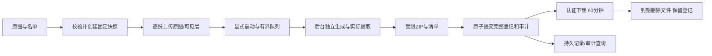

# 多图分发与审计设计

输入：requirements.md Confirmed，main交付。新增多图任务，不改Go DCT v1协议。标准库优先，无外部发送。

## 边界与关键取舍

- internal/distribution：业务状态、受保护密钥、任务登记及审计的同一原子提交边界。
- internal/delivery：后台执行、输入和成品目录、队列/并发/取消/清理；依赖distribution及blind，不依赖HTTP。
- cmd/server：认证/同源、受限上传、动作映射及API，不把HTTP日志当审计。
- frontend：任务页/审计页；复用现有canvas及本机模板，渲染预览的相同PNG逐份上传后排队。可见文字不由服务器重新排版，客户端负责文字可见层；服务器验证像素格式/尺寸/摘要和隐形载荷，不宣称OCR认证文字。

## 原子存储与迁移

已有keys.enc与records.json分别提交，不能保证密钥操作与独立审计文件的一致性。本轮增加v2规范快照platform.json：签名封套内包含旧批次、任务、审计及AES-GCM加密的密钥字段。密钥材料始终加密；元数据仍为受HMAC保护的受限文件。每次业务修改和审计追加形成同一新快照，临时写入/fsync/rename/目录fsync后发布内存状态。HMAC采用独立platform-v2派生域。

旧v1启动先验证原标记/密钥/记录及主密钥；生成完整v2快照再将format.json更新为version2。升级过程中已有快照则验证后完成标记，绝不重新生成密钥/标识。旧keys.enc/records.json仅保留为升级时只读历史，不再作为v2真值；备份改为format.json+platform.json+外部主密钥。禁止用旧二进制回滚读取已经升级的数据；回滚须恢复升级前整套备份和对应程序。迁移完成前后都持有同一独占锁；私有目录0700/文件0600，拒绝符号链接。

新安装同样进入v2；旧测试中针对具体磁盘格式的断言更新为规范快照，保留完整v1迁移/损坏/错误主密钥负例。读到损坏/未知版本拒绝启动，不静默置空。

审计与业务一文件保证原子一致；落盘结果不确定时进入degraded并拒绝后续关键写，返回明确“状态不确定，重启后查询再重试”，不是断言没有执行。重启读取实际原子快照，因此业务和审计一起出现或一起不存在。登录继续；不安全的业务读取可拒绝，管理端显示降级告警，不假称完整留痕。

## 数据字段

| 对象 | 新字段与校验 | 默认/生命周期 |
| --- | --- | --- |
| Platform v2 | version=2、batches、sealed_keys、jobs、audit、audit_sequence | 原子规范文件，最大64MiB，累计任务1000、审计100000；满时拒绝，不清空历史 |
| Job | id32hex、request_hash、fingerprint、operator、last_actor、created_at、key_id、algorithm、mode、template_text、style快照 | 同请求同输入复用；原始幂等键不落盘 |
| Source | id32hex、name<=255B、source_sha256、width/height、uploaded | 1～5张，摘要唯一；实际上传核验，源图总大小<=128MiB |
| JobCopy | id32hex、source_id、recipient_id/name、rendered_sha256可空、input_uploaded | 全矩阵<=100，标识独立；原图与渲染摘要分开 |
| Job state | status、phase、done/total、attempts、error、generated、archive_sha256/size、expires_at | preparing/queued/processing/cancelling/completed/failed/cancelled/interrupted；下载状态独立计算 |
| AuditEvent | sequence、id、at、actor、action、target、attempt/correlation、outcome、code | 仅受控动作及错误码，目标只用服务端标识；无正文/名单/凭据/搜索词 |

模板只允许{name}/{recipient_id}，替换后沿用可见文字80字符/单行及样式限制。原图和渲染图尺寸相同；仅双水印需要逐份渲染输入，未渲染模式直接使用原图。使用现有密钥版本固定时间和ID。开始后切换/停用不撤销当前执行快照；停用阻止新的Start/Retry。未开始或重试时校验版本仍可用。

创建时校验列表，上传后才可信地确认实际原图尺寸/摘要/容量。输入变化需新幂等键；重试若有历史rendered_sha256必须完全匹配，字体差异导致不同像素则明确冲突，不假装原副本。已完成任务到期不重生成旧包，仍可按登记提取；旧单图重生成不变。

## 文件、执行与恢复

- runtime：请求暂存，启动继续清理。
- jobs-inputs/<jobID>：原图和rendered输入，单任务<=512MiB；任务终态删除。准备中最多15分钟，过期标失败；重启未完成任务标interrupted，清理输入，明确要求重传。
- artifacts/<jobID>.zip：完整包，最大128MiB，完成起60分钟有效；请求结束/正常重启不删除；启动及周期清理到期文件，未知/部分包清理。下载核对长度/摘要；缺失/损坏标unavailable，不修改generated事实。
- 全部任务文件总预算2GiB；非终态任务最多4，后台最多2并复用全局盲水印两槽，逐份解码/生成，不把100张图同时放内存。原图每张<=50MiB/8MP，总源文件<=128MiB。
- HTTP每次上传一张<=50MiB，逐份累计限制而非单次超大multipart。输入上传不套每分钟10次业务动作额度（100份无法完成），但有认证、槽位/队列/字节预算及只接受快照定义的有限文件；任务创建/启动/重试/取消/下载仍受现有动作限流。
- Worker真实生成并提取每份标识后更新done，进度可为内存观察值，终态与登记原子持久化；重启在途状态标中断，不伪装继续。成功打包、fsync成品后提交completed/generated及审计，才允许下载；事务失败未确认的孤儿包不交付。
- ZIP以安全编号目录分接收人，随机标识PNG命名；manifest包含源ID/原文件名、接收人/副本ID及密钥，CSV防公式。取消/失败删除部分包。任何已生成包不代表实际送达。
- 显式取消设置cancelling并取消上下文；当前单次编解码/嵌入完成后退出。关页不取消已启动任务。正常关闭取消worker并标中断，等待释放后关闭Store。

## API契约（均新增，受认证/同源）

| 路径 | 输入 | 输出 |
| --- | --- | --- |
| POST /api/jobs | JSON sources[{name,source_sha256,width,height}]、recipients_csv、mode、template_text、style；Idempotency-Key | Job preparing，固定Source/Copy标识 |
| POST /api/jobs/:id/inputs | multipart file、source_id、可选copy_id | 核验输入并标uploaded；重复同内容幂等，不同内容409 |
| POST /api/jobs/:id/start /retry | 无正文 | queued；已在执行不重复启动；完成不可重试 |
| POST /api/jobs/:id/cancel | 无正文 | cancelled/cancelling |
| GET /api/jobs/:id | 无 | 实际任务/进度及download_state |
| POST /api/jobs/search | JSON q/page/page_size | 分页任务列表，轮询不写业务审计 |
| GET /api/jobs/:id/archive | 无 | 未过期完整ZIP；过期410、未就绪409、缺失/损坏明确失败 |
| GET /api/audit/status | 无 | configured/degraded/limits，无递归审计 |
| POST /api/audit/search | JSON from/to/action/actor/outcome/page/page_size | 分页事件，降级状态明确 |
| POST /api/audit/export | 同筛选及format=json/csv | 全匹配范围，最多10000，超限422，不静默截断 |

旧batches/records查询及Lookup额外关联已完成JobCopy。原有字段保持，新增job_id/source_id/rendered_sha256可选区分多图。任务的未完成副本不作为已生成登记。保持verify/report使用现有Lookup验证密钥、算法、签名时间和标识。

## 审计覆盖与错误

关键成功写在域事务内追加（新旧批次、任务、密钥），错误尝试由HTTP受控动作适配器追加。认证Login成功设置可信username，失败为anonymous，不记录提交文本；Logout先识别当前账号。提取/溯源/报告验证、下载观察与登录结果用受控动作映射，不存URL查询/输入正文。请求关联ID由服务端生成，不信任外部任意文本。

下载开始先写attempt，结束仅写服务端响应结果，不称收件人收到；HTML/JSON在浏览器保存不记为已接收。状态轮询/会话探测/静态资源不写审计。独立审计追加失败会显示状态告警并阻止后续关键写；已经返回的读取不会被伪装改写为业务失败。全局状态接口供已登录UI持续显示降级。

新功能要求持久配置，未配置返回platform_config，旧单环境模式保持可用且显示未启用审计。迁移首条事件标migration，不补写虚构旧操作。记录依赖受限主机/主密钥，没有第三方防伪/可信时间承诺。

## 验证与发布

测试真实2图×3人逐份提取/映射、双水印预览输入摘要、原图不变、幂等并发、参数/容量/路径、取消/超时/故障/进度、重传/密钥快照、进程重启保留成品与过期、v1完整迁移/损坏、审计原子性/隐私/筛选导出/降级、原有回归及中英浅深/390px实操。实际查看截图并逐项对照11项验收。部署前停止并备份v1整套数据和主密钥；本次仅main交付，不部署线上。
