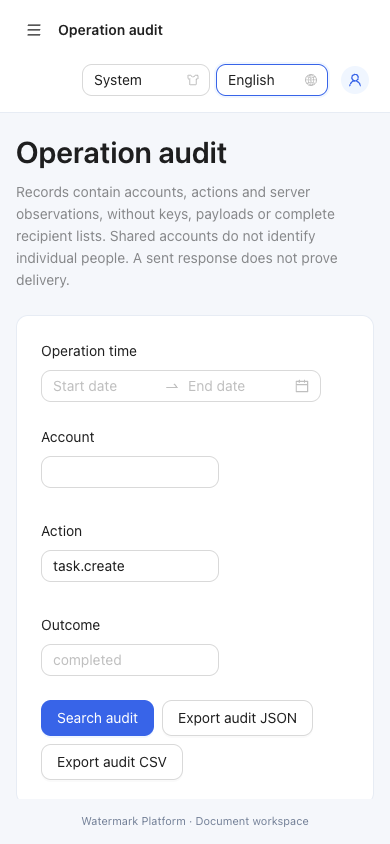
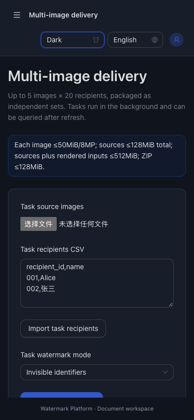

# 多图任务、批量双水印与操作审计：验收记录

验收日期：2026-10-26～27（Asia/Shanghai）。范围：[已确认需求](requirements.md)、[设计](design.md)、[实现计划](implementation-plan.md)。实现基础提交为630367e、55a2021，最后补充旧批次在审计降级时的新执行保护。本记录描述本地隔离环境的实测，不代表生产部署。

## 自动验证及复现

在仓库根目录执行：

```sh
go test -race ./...
go vet ./...
npm --prefix web/frontend run build
PLAYWRIGHT_CHROME_PATH='/Applications/Google Chrome.app/Contents/MacOS/Google Chrome' npm --prefix web/frontend run test:e2e
node web/frontend/scripts/restart-smoke.mjs
```

- Go全量race、vet通过；最后写保护修复另有聚焦race检查，并再次运行全量检查。
- TypeScript及Vite生产构建通过。Ant Design包约1096kB（gzip约341kB），有大于500kB的构建提示；不是构建错误。本轮未以抬高阈值隐藏提示。
- 浏览器脚本依次启动5套隔离服务，6项真实流程全部通过：平台2项、单图分发1项、实验/双水印/报告1项、多图双水印1项、取消/恢复1项。使用真实后端和浏览器下载文件，不以模拟成功响应代替生成。
- 重启脚本编译实际Go二进制，使用独立临时目录、随机本地端口及公开测试凭据；验证正常重启、错误主密钥、SIGKILL恢复、真实8秒TTL过期及重试。原图在运行前后计算摘要，输出均从副本生成。
- 测试输出和下载归档保存在系统临时目录，不提交真实素材、凭据或下载包。下方截图仅包含合成测试数据。

## 逐项证据

| 验收 | 要求 | 实际检查与结果 |
| --- | --- | --- |
| AC-001 | REQ-001～004 | 域测试、delivery真实ZIP测试及jobs浏览器流程均运行两图三人矩阵。6份实际嵌入、提取、登记匹配；清单与接收人目录对应；原图摘要不变。 |
| AC-002 | REQ-002/004/005 | 重复源摘要、超过5图/20人、坏图、容量与透明度、重复编号、总输入、磁盘预算和模板错误均明确拒绝。包大小失败使用内部限额1024字节的真实打包测试验证整包失败，不声称生成了128MiB超限样本。浏览器确认超宽文字在建任务前报错。 |
| AC-003 | REQ-003/005 | 浏览器先生成并选择每图/每人预览，再提交相同渲染字节；下载6张中英双水印PNG逐张经真实验证接口核对ID、时间、原图及渲染摘要。姓名中的占位符不递归替换。 |
| AC-004 | REQ-006/007 | 实际已生成并验证份数推进；打包/持久提交前不可下载。幂等同请求复用，异输入冲突，并发重试拒绝；刷新与会话恢复查询已有任务，无重复登记。 |
| AC-005 | REQ-007/008/010 | 上传中取消、旧上传令牌迟到拒绝、执行中取消、输入重传、同摘要重试均有测试；真实进程SIGKILL后恢复为interrupted，原任务/副本ID及时间不变，重传后成功，不开放部分包。接近128MiB源输入在清理后重传，不重复计算历史槽大小。 |
| AC-006 | REQ-009/010 | 完成ZIP跨正常重启保持相同摘要；实际TTL到期清理文件但Lookup仍登记。delivery测试还覆盖同长度损坏、文件缺失与过期状态；生成状态独立于下载可用性。 |
| AC-007 | REQ-007/011/016 | 轮换后在途快照不变，旧水印可验证；停用拒绝新重试。真实v1夹具迁移及旧固定算法夹具通过；旧单图幂等重生成跨重启ZIP保持相同摘要。 |
| AC-008 | REQ-012～014 | 真实登录、任务、旧批次、密钥及验证操作留下可信账号/目标/结果，查询和轮询不灌入审计。精确筛选、含当日末尾的时间范围、分页、JSON/CSV及公式安全转义有测试；超10000条导出明确拒绝截断。导出/日志无名单全文、载荷或主密钥。 |
| AC-009 | REQ-014/015 | 模拟快照写前失败与rename成功但返回失败，重启后业务/审计一起存在或一起不存在。真实HTTP通过阻断规范文件写入触发降级，关键写503、安全读取/认证仍可用且状态告警；修复后重开无半条密钥。损坏/错误主密钥拒绝且不重置数据，未验证数据前不清理临时文件。审计降级拒绝旧批次新重生成，允许在途结束；有容量和资源预算检查。 |
| AC-010 | REQ-012～016 | 未登录及跨站写受保护。平台、双水印、报告、任务及审计流程覆盖中英/浅深主题；390px任务刷新与审计筛选无页面横向溢出，宽表格在自身区域滚动。侧栏全高、菜单独立滚动、底部固定。 |
| AC-011 | REQ-016 | race/vet、生产构建、6项浏览器流程与真实进程检查通过；README/API/配置/迁移、根日期分类CHANGELOG及本记录同步。直接main交付沿用用户约定；最终同步结果见workflow.md。 |

测试位置：`internal/distribution/platform_store_test.go`、`internal/delivery/manager_test.go`、`cmd/server/jobs_test.go`、`web/frontend/tests/jobs.spec.ts`、`web/frontend/tests/jobs-cancel.spec.ts`，以及既有平台/分发/工作台回归。

## 实际界面






截图为真实测试会话。桌面任务截图停留在完成详情与历史区域；手机恢复截图为刷新后页面，文件输入需重新选择，浏览器不会保存原图。

## 边界与升级

- 本轮保持单管理员、单实例：审计只标识账号，共用账号不能区分个人。服务端完成下载响应不能证明实际收件或泄露归属。
- 字体由本机浏览器提供，缺字/宽度检测属于尽力检查，不能保证任意系统/字体均可用；创建前必须检查预览。未新增跨设备字体打包或几何攻击恢复承诺。
- ZIP最多暂存60分钟，可配置缩短；过期不承诺原包再生成，登记继续保留。输入终态清理，任务/审计元数据有硬上限而非无限存储。
- v1自动升级到v2规范快照。升级前停止服务，备份完整数据目录及外部主密钥；升级后以format.json/platform.json为规范真值，旧keys.enc/records.json只是历史。旧二进制回滚须恢复升级前完整备份，不可直接读取新目录。
- 无新增生产依赖，不依赖外部水印项目；算法/legacy/CLI旧回归保留。旧Office/PDF测试缺少可选外部样本时仍按原有条件跳过，不据此宣称重新验证所有办公软件。
- 无生产部署、线上迁移或对外发送。本次是代码、文档及本地验证交付；没有创建版本标签或发布包。
