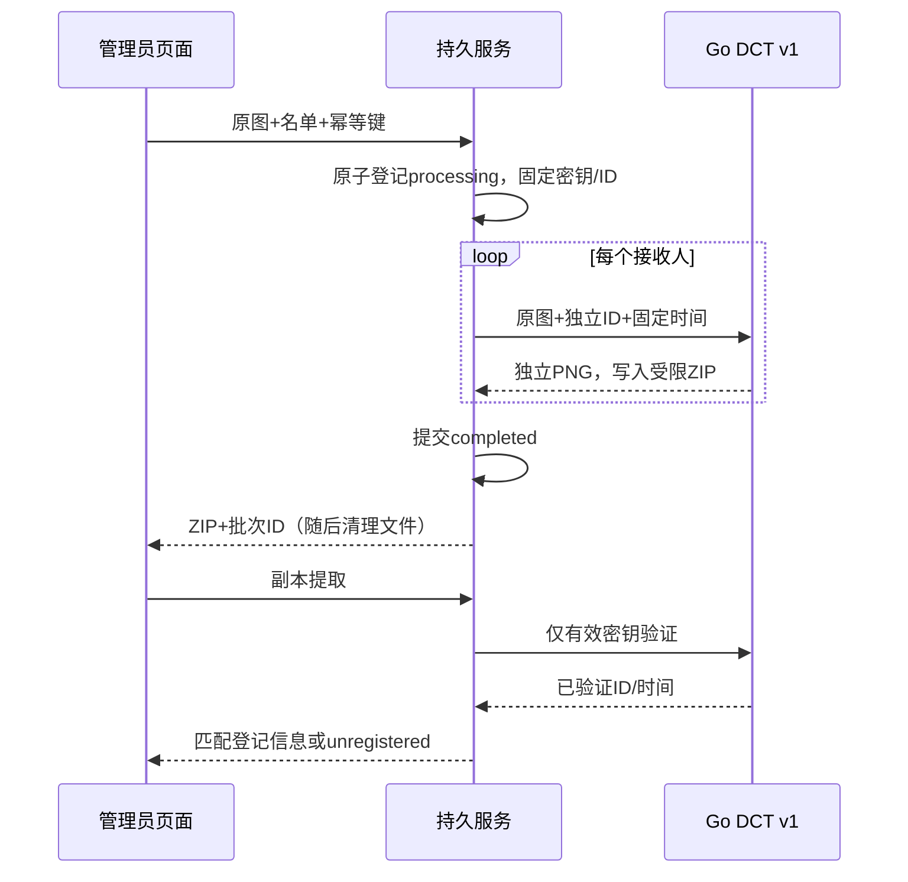

# 分发溯源与密钥管理设计

输入为已确认 requirements.md。P1–P6 依赖现补齐，允许实现；main 遵循用户既有要求。维护门禁：中风险，新增 internal/distribution 独立域，按存储/密钥/批次/查询拆分；HTTP 与 React 页面分离，不继续扩大旧水印算法文件。

## 部署与持久边界

单管理员、单实例。显式配置 WATERMARK_DATA_DIR（私有目录）及 WATERMARK_DATA_KEY（32字节hex主密钥）；两者都不配置时旧功能照常，新功能503。配置不完整/状态损坏则启动失败，不静默重置。首次启用导入 WATERMARK_BLIND_KEY 为 legacy-env，否则创建随机当前密钥；重启时不重复导入，若提供的旧环境密钥与导入值冲突则拒绝启动并说明迁移规则。

标准库实现：私有目录0700，文件0600，系统文件锁排除第二写进程（macOS/Linux；不支持的平台明确拒绝持久模式）。format.json标识初始化阶段；keys.enc 使用 AES-GCM 主密钥保护；records.json 使用域分离HMAC保护完整性，元数据与密钥材料分离。临时写、fsync、rename、目录fsync后发布内存快照；不确定写失败使当前实例进入明确的存储不可用状态，需重启核对。主密钥不入数据目录、不进入API/日志。启动发现 processing 批次改为 failed/interrupted 并持久化。

## 对象与状态

| 对象 | 字段 | 生命周期与约束 |
| --- | --- | --- |
| Key | id/state/created_at/updated_at/created_by，内部secret | 最多8个版本；active唯一，创建默认仅提取；切换active将旧active降为decrypt-only；不能直接停用当前密钥，先切换；disabled不参与验证；网页永不返回secret |
| Batch | id/request_hash/fingerprint/source_sha256/operator/created_at/key_id/status/error/attempts/copies | processing→completed或failed；重试保持ID、载荷时间、密钥、名单；最多10000批，满后拒绝而非自动删除 |
| Copy | id/recipient_id/recipient_name | 32位随机hex标识，适配v1的34字节容量；编号在批内唯一，显示名可重名；批内最多20人 |
| Temporary archive | request-scoped directory | 一图多独立副本；ZIP128MiB封顶；响应完成后删除，无长期下载链接 |

记录未加密但以文件权限保护并签名，包含登记接收人；运维备份必须同样受限。生成状态 completed 表示副本生成且记录提交，不等同于收件人实际收到。

## 幂等与一致性

请求 Idempotency-Key 16–128字符，仅保存其摘要。指纹覆盖原图摘要、有序规范化名单和操作者。同key不同输入409；同批并发409 busy；已完成/失败的同请求使用原ID与时间重新生成临时ZIP，不新增分发记录。重启后记录保留但原图/ZIP不保留；记录页要求重新上传摘要一致的原图进行重生成。原密钥停用后无法重生成，明确报错。批次开始时固定密钥快照，后续切换不影响该次处理。

所有成员先登记 processing，生成完整受限ZIP后才提交 completed；处理失败标failed且不交付部分ZIP。失败或磁盘提交不确定时不返回成功包。两槽并行限制与原单图模式共享，每批内部串行处理，所有成员从同一原图解码数据独立Embed，不在上一副本上叠加。

## API / 页面

- GET /api/platform/keys；POST /keys 创建；POST /keys/:id/state {state} 修改。均在现有认证与同源保护内。
- POST /api/platform/batches：multipart file、recipients_csv，Idempotency-Key头；成功ZIP，X-Batch-ID；未知/非法名单400、冲突409、忙429、存储503、图片422。
- POST /api/platform/batches/:id/download：原图file，摘要须匹配；生成原批次下载，不重新登记。
- POST /api/platform/batches/search 与 /records/search：JSON {q,page,page_size}，默认20/最大100；搜索词走请求体，日志只记录路径与状态。
- POST /api/platform/trace：图片及可选key_id；自动仅尝试未停用密钥，显式选择停用版本409 key_disabled。旧v1包无外露key_id，自动未检出不能断言用了某个已停用版本。
- 现有go-dct-v1单图模式在启用持久配置后使用管理密钥；验证按受控密钥快照尝试；成功附key_id、match和可选登记记录。未配置持久功能时原环境变量路径不变。legacy与CLI不变。

匹配登记必须同时满足已完成批次、载荷ID、验证密钥ID和签名时间；普通有效文本/无本地记录显示unregistered，不把它当作未检出或实际泄露者判断。CSV标准库encoding/csv，UTF-8/BOM，header为recipient_id,name，最多20行，编号≤64字节、名字≤128字节，重复编号拒绝。ZIP文件名只用随机ID，不拼接名单路径。

Web 新增批量副本、记录查询（批次/副本/图片溯源）、密钥版本页面；复用主题/中英词典/错误状态。密钥状态变化有明确确认；默认表格不暴露材料。记录页可上传原图重新生成ZIP。表单修改重置幂等键，失败重试保留；数据状态以服务端为准。

## 实施与验证

1. 存储/密钥/批次领域及故障、重启、并发、密钥迁移测试。
2. HTTP包装、受限ZIP、统一密钥验证与auth上下文；真实API多接收人往返及未授权检查。
3. 三个React页面、CSV导入与双语；浏览器ZIP/溯源/切换密钥/重生成回归；旧模式和v1夹具继续验证。
4. README/CHANGELOG/备份恢复说明与验证证据，go test -race ./...、go vet ./...、前端构建、diff检查，分阶段推送main。

备份：停止服务，将整个数据目录和外部DATA_KEY分别安全备份；恢复整套keys/records/format后用同一主密钥启动，禁止只复制单文件。回滚不删除数据，旧版本无法读新记录；关闭持久配置可回到旧路径，但不会自动导出管理密钥。未执行外部部署或数据清理。
