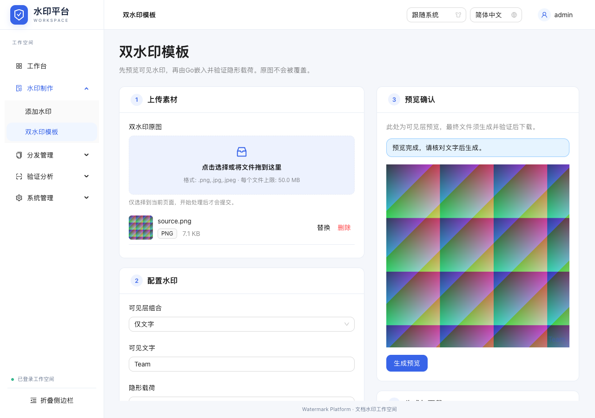
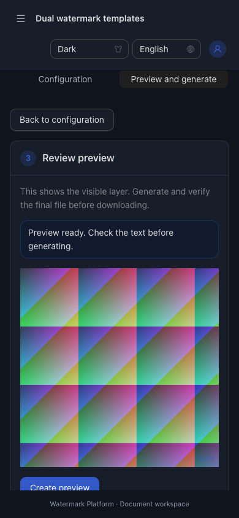
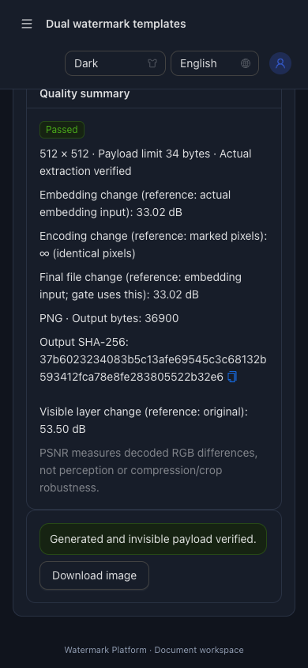
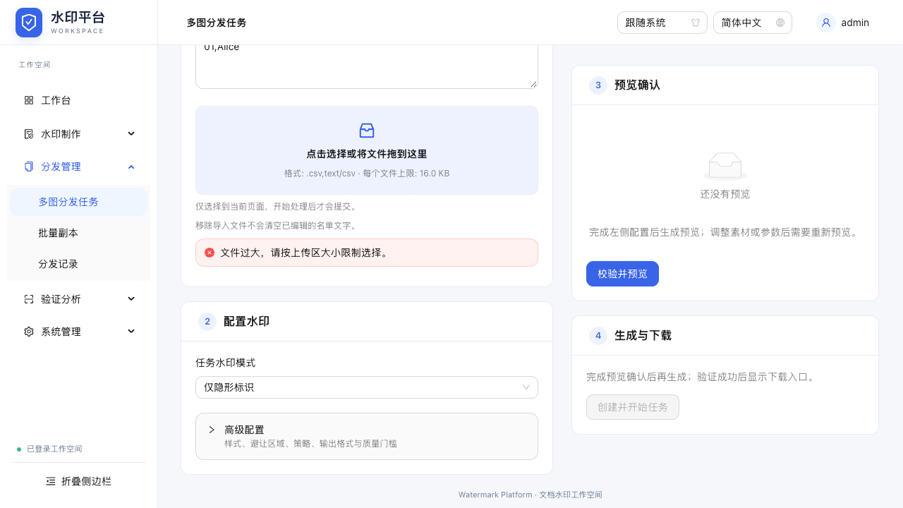

# 表单工作区验证

日期：2026-10-27。实现22ef2a6，资源清理8adbf1b。真实本机Chrome、专用:18080 Go服务、合成测试数据；不修改原始fixture。

## 检查记录

- 生产构建：`npm --prefix web/frontend run build`，TypeScript/Vite通过；仍有既有AntD vendor大包提示，无新增生产依赖。
- 新增专项：`PLAYWRIGHT_CHROME_PATH='/Applications/Google Chrome.app/Contents/MacOS/Google Chrome' npm --prefix web/frontend run test:e2e -- form-workspace.spec.ts`，2项通过，包括资源释放补充验证。
- 最终资源清理补丁后完整套件：`PLAYWRIGHT_CHROME_PATH='/Applications/Google Chrome.app/Contents/MacOS/Google Chrome' npm --prefix web/frontend run test:e2e`，10个独立服务窗口、12项用例全部通过，退出0；最终代码8adbf1b。
- `git diff --check`通过。Go/API/数据协议未改，不重复无关Go单元套件；E2E使用真实Go后端执行嵌入、验证及下载。

## 需求与验收对照

| 要求/验收 | 当前证据 |
|---|---|
| REQ-001 / AC-001 | DualPage、JobsPage各有四个FormStage；共享AdvancedSettings默认无openKey、forceRender保值；专项检查默认关闭、基础输入可见、高级字号修改并收起后保留 |
| REQ-002 / AC-002 | 共享Grid/sticky/max-height与≤1100px切换；专项1280px左右位置/滚动顶距、1024px与390px切换、字段及真实预览/成品保留、页面无横向溢出 |
| REQ-003 / AC-003 | 全部生产type=file仅FileUpload一处；两项专项实际拖放、选择器、键盘Enter、追加、逐项替换删除、CSV及文档图标；Logo由原有真实Logo/JPEG回归覆盖 |
| REQ-004 / AC-003,004 | 单份50MiB/数量/128MiB合计、CSV16KiB原子拒绝；保留有效文件与已有成品；生成时替换/删除禁用；双水印替换后旧预览/下载清除，多图删图后预览消失且创建禁用 |
| REQ-005 / AC-003,005 | 操作前无workbench处理POST；CSV删除保留文字；替换URL清理与隐藏的草稿页旧blob URL实际不可fetch，回页面File仍在、新URL恢复 |
| REQ-006 / AC-004,005 | 中文桌面、英文暗色手机、键盘上传；真实双水印验证成功与下载、多图六份JPEG ZIP实际逐份提取、错误修正/取消恢复沿用完整业务回归 |

## 文件入口清单

- WatermarkPage：添加/提取，沿用服务端支持格式与Go模式PNG/JPG。
- DualPage：双水印原图；ArtworkControls：双水印/任务Logo，5MiB。
- JobsPage：任务原图（5张/128MiB）及16KiB CSV，UTF-8解码错误就近显示。
- BatchPage：批次原图及16KiB CSV。
- TraceForm：登记溯源；TraceBatchPage：20张/128MiB批量溯源。
- LabPage：实验原图；RecordsPage：重建ZIP原图，变更清旧归档。

## 视觉与边界

检查实际截图：双水印中文桌面、手机英文暗色预览/验证成品、任务多图上传。无真实个人数据。最终版本截图在screenshots/归档。

保留hash、单管理员授权、Go算法、任务状态与质量门槛。预览由用户主动触发；不承诺实时预览。后台任务结果仍在任务详情与历史区域，不把新素材与既有任务成品混为一份。本轮不部署。

## 最终完整回归

| 套件 | 用例数 | 结果 |
|---|---:|---|
| form-workspace | 2 | 通过 |
| navigation | 1 | 通过 |
| platform | 2 | 通过 |
| distribution | 1 | 通过 |
| workbench | 1 | 通过 |
| jobs | 1 | 通过 |
| jobs-cancel | 1 | 通过 |
| trace-quality | 1 | 通过 |
| logo-exclusion | 1 | 通过 |
| jpeg-jobs | 1 | 通过 |

首轮完整回归曾在旧用例“原生Logo input可见”断言失败；统一组件有意隐藏原生input，改为断言用户可见的上传区及文件为空，保留真实选择与生成检查。其余改动是按实际UI展开高级区、切换预览面板，以及定位内层质量卡片，没有移除原业务验证。

## 截图

