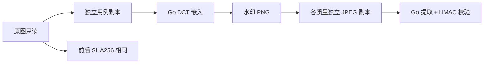

# Go 图片盲水印 v1 设计与实施计划

输入：已确认 requirements.md。Workflow gate：允许实现；现有接口和前端页面可复用。Maintainability gate：中风险，算法独立 internal/blind，文件适配与 HTTP 处理分离；不向现有图片处理器叠加算法。用户指定 main，不创建 PR。

## 算法与数据契约

完全独立 Go 实现，标准库 image/jpeg/png、math、crypto/hmac/sha256/rand、encoding/binary。8×8 亮度块，投影到正交 DCT 基 (1,2)/(2,1)，通过系数差正负和固定最小间隔嵌入比特。逆变换只应用两系数的增量到 RGB。使用密钥派生的 HMAC 计数流打乱块顺序，重复编码并多数表决恢复；重复不是密码学安全或通用纠错码。

固定 64 字节包：magic 4，version 1，UTF-8 长度 1，Unix 秒时间戳 8，文本区域 34（尾部零填充），HMAC-SHA256 截断 16。最大文本 34 字节。提取不需要原图、外部 wm_shape 或文本长度。每 bit 至少 3 个块，共 1536 块；容量不足拒绝。图像最大 8 MP，PNG/JPEG，透明像素拒绝；超限和损坏图片明确报错。尺寸不变，忽略边缘不足 8 像素的块。

密钥：WATERMARK_BLIND_KEY 为 32 字节 hex（64 hex 字符），服务端/CLI读取，不进入前端或日志。缺配置只阻止新模式，不影响旧模式。v1 单密钥；更换密钥后需要旧密钥提取旧水印，文档明确备份。HMAC证明载荷由该密钥生成，不证明图片内容未修改，不加密文本。

Result：watermark string、timestamp RFC3339、algorithm="go-dct-v1"。错误区分 blind_not_found、blind_invalid（版本/载荷/签名无效）、blind_capacity、blind_image、blind_key、blind_text。错误密钥通常表现为未检出；不以随机解码或乱码宣告成功。

## 集成与生命周期

- 旧 API 默认 legacy 行为与成功字段不变。
- multipart 新增 algorithm=go-dct-v1；缺省 legacy；未知算法 400；新模式只接受图片。新模式下载输出 PNG；响应 X-Watermark-Algorithm。提取成功新增 algorithm 字段，timestamp 根据原 show_timestamp 选项输出。
- 新模式文件处理路由在独立 cmd/server/blind.go，复用认证/同源/限流/上传限制；算法限制像素数和文件体积，避免遗留异步超时清理问题。
- CLI 新增 blind-add/blind-extract；输出路径必须不存在，绝不覆盖输入或已存在文件；支持 .png 或 .jpg/.jpeg 输出（JPEG=95）。
- Web 添加/提取页提供模式选择，显示新模式限制；新模式只允许 PNG/JPG，文本按 34 字节；兼容模式按旧限制。结果展示验证成功，不显示密钥输入框。

## 实施切片与验证

1. internal/blind：算法、载荷、资源边界及文件适配；合成图和负例单元测试、DCT 基本数值验证。
2. cmd/blind-bench：标准库下载显式 URL 的原图，独立副本、PNG重编码/JPEG95/85/75、PSNR/耗时/哈希、JSON与Markdown报告；至少照片、纹理、图表类真实样本。照片下载不入库；新增人工图是补充而不是替代真实样本。
3. HTTP/CLI/Web 集成；认证真实 HTTP PNG/JPG往返与浏览器新旧模式回归。
4. README、根目录 CHANGELOG 日期分类、verification.md；go test -race ./...、go vet ./...、前端构建、git diff --check，提交推送 main。

不预先保证 JPEG 任何质量档位都通过；按实测报告边界。裁剪/缩放/旋转仅探索测试，不属于 v1 无条件能力。回滚需前后端一起回滚；旧模式保持，v1 输出依赖版本与原密钥。无数据库或水印记录服务，不虚构溯源记录。
