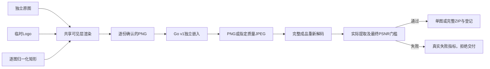

# Logo、避让与最终文件导出设计

输入为Confirmed requirements.md。本文定义待实施契约，沿用main源码交付，不部署，不新增生产依赖。

## 数据流与边界

浏览器拥有Logo像素与可见层排版，Go负责输入限制、参数验证、固定身份、实际输出编码/验证、质量和任务原子终态。渲染摘要证明重试输入相同，不是Logo识别认证。

## 字段与兼容

| 对象 | 新字段 | 类型/校验/默认 | 所有权和兼容 |
| --- | --- | --- | --- |
| Output | format,jpeg_quality | png默认；jpeg及整数60～100/默认90 | 标准库输出模块；显式默认PNG规范为省略，保持旧指纹 |
| Artwork | layers,logo?,exclusions? | text默认；logo/both需Logo，Logo sha256/position/width_ratio 0.05～0.4/opacity 0.05～1；exclusions为源摘要→最多8个矩形 | 任务固定快照；旧nil表示原文字行为 |
| Rect | x,y,width,height | 归一化0～1，宽高正且完整在原图内 | 逐原图摘要绑定，手机/缩放不改坐标 |
| Job | output?,artwork? | 可选，深拷贝，指纹纳入非默认字段 | v2可选字段，旧记录可读，不重新评价 |
| Quality Summary | encoding?,final?,output_sha256?,output_bytes?,format?,jpeg_quality? | 指标区分finite/infinite/unavailable；最终验证失败verified=false/accepted=false | 旧无final继续用embedding；新门槛使用final，真实失败摘要也可保存 |
| 本机策略 | 可选layout/output | 只含layers及Logo布局标量，不含sha/图/矩形 | 接受旧v1精确字段，新增字段独立严格校验；20项/3内置不变 |

新增internal/output负责Options、受限编码、实际解码/提取/摘要；internal/composition只校验艺术层身份/矩形/深拷贝，不处理字体。internal/quality继续负责数学度量，新增GateMetric兼容旧历史。现有Style六字段不扩展，避免破坏旧模板。

## 可见层与编辑器

共享ArtworkControls及ExclusionEditor在单图和任务复用，鼠标/触摸Pointer Events框选；数值表可编辑百分比、删除/清空。选中原图按实际SHA绑定，每次文件变化取消旧预览；不同图片不靠数组序号继承。Logo只在当前页面内存，解码前检查5MiB/200万像素，保持纵横比，允许alpha。

renderVisible增加可选composition参数。文字/Logo绘制到独立透明层；每个实例先计算含旋转的实际边界，与避让矩形相交则跳过整实例；单处按用户位置优先再尝试其余五位置。每种启用层至少一次，失败为artwork_blocked。最终合成前保证避让区域的可见层alpha为零，避免抗锯齿边缘侵入。该检查不约束后续盲嵌入或JPEG。旧文字无artwork走同一共享逻辑但保持旧布局和旧渲染身份。

## API与执行

单图Go add、/workbench/dual可选multipart output JSON；dual继续上传确认的PNG和原图用于质量，Logo原始文件不上传/落盘。返回实际Content-Type/文件名，X-Watermark-Quality含最终摘要；失败422有受控code及quality，不把失败PNG冒充JPEG。

/jobs/preview-plan和/jobs增加可选output/artwork，独立严格校验。Logo-only不强制非空文字；其他文字规则保留。服务器核对exclusions源摘要属于该任务，不能与blind模式混用可见层。渲染输入仍逐份上传、固定摘要。客户端恢复全部快照并提示重选同一Logo，核对Logo摘要与渲染摘要；仅格式/质量/避让变化也拒绝重试错配。

delivery逐份调用输出模块，先完成真实编码/验证和最终门槛，保存实际质量摘要再写ZIP；扩展名png/jpg与字节一致。清单质量JSON提供格式、字节数和SHA；任一失败保留失败指标，整个任务失败，不开放部分包。原子生成登记、取消/重启/令牌/15分钟准备/60分钟归档规则不变。

## 生命周期、资源和恢复

Logo限本机临时，计入预览512MiB预算，图片每份50MiB/8MP，原图总128MiB、任务5×20、ZIP128MiB和全局2GiB不变；逐份编码不同时保留100张解码图，编码器输出50MiB上限。输出/参数错误不启动任务，实际编码失败不自动调整质量或算法。取消在编解码步骤间生效。

旧数据无新字段为PNG/文字，不破坏旧请求指纹；旧本机策略加载不清空。新策略要求重选Logo，不保存内容/区域。升级前完整备份目录及主密钥；旧二进制不理解新Logo/输出快照，不可用其继续新任务，回滚恢复升级前备份。审计仅受控操作/编号，不保存图/名单/正文。

## 验证与边界

纯Go测试最终解码提取、PNG/JPEG签名/MIME/摘要、JPEG编码损失/最终门槛、失败六份整包、旧指纹/持久库。真实浏览器测试透明Logo、文字/Logo/both、像素避让、无位置失败、逐图/触摸数值编辑、策略旧存储、格式下载真实提取、恢复错误输入、手机中英/主题。F5证据逐项映射12REQ/8AC，最终race/vet/build/完整E2E及重启冒烟。

不研究AI检测、不可见像素保护、新抗JPEG算法、SVG/动画Logo或永久素材库。无额外待决问题。
