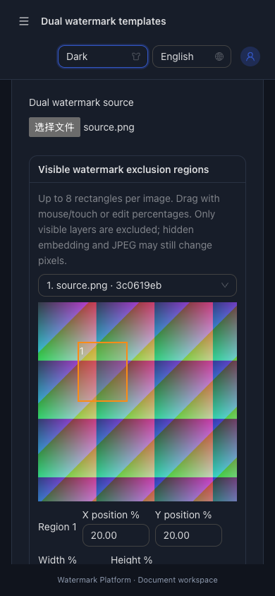
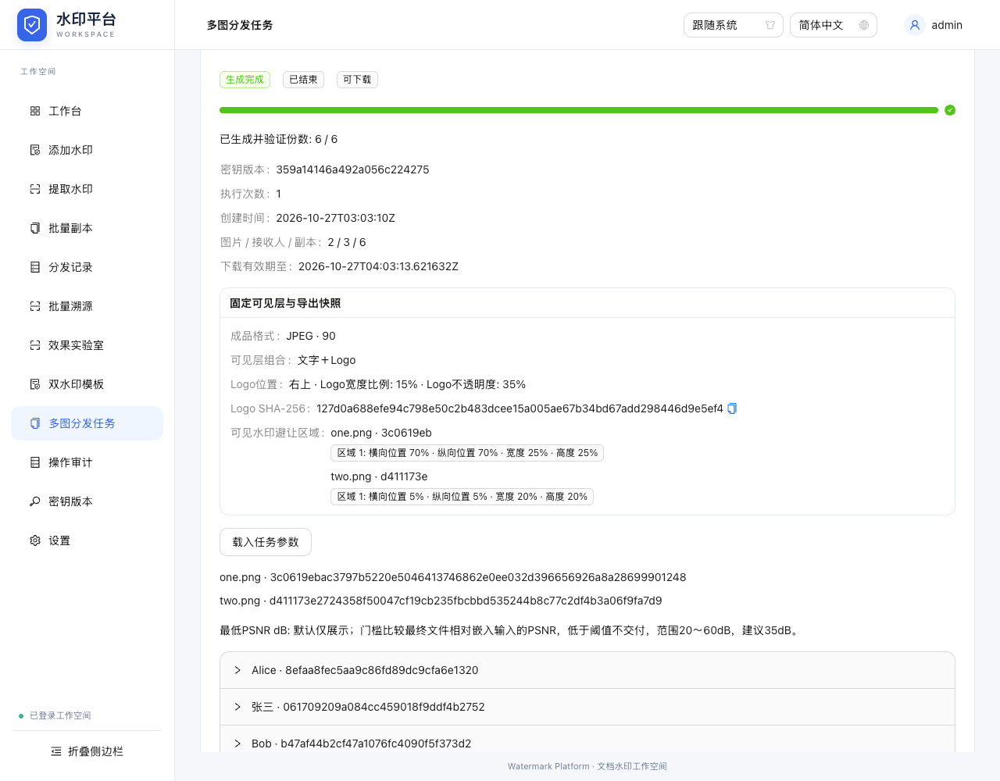

# Logo、区域避让及最终JPEG：验收记录

验收日期：2026-10-27（Asia/Shanghai）。输入：[已确认需求](requirements.md)；实施契约：[设计](design.md)、[计划](implementation-plan.md)。本记录证明本地源码交付，不代表线上部署。

## 检查命令与结果

```sh
go test -race ./...
go vet ./...
npm --prefix web/frontend run build
PLAYWRIGHT_CHROME_PATH='/Applications/Google Chrome.app/Contents/MacOS/Google Chrome' npm --prefix web/frontend run test:e2e
node web/frontend/scripts/restart-smoke.mjs
```

- 最后全量Go race/vet通过，delivery包含新增JPEG归档/中断恢复检查（52.024s），其他已通过包使用缓存。CLI源码未修改，本轮证明为编译、旧协议/文件测试及已有冒烟，不声称逐条手工复跑全部CLI选项。
- TypeScript/Vite生产构建通过。Ant Design包约1114kB（gzip约346kB）仍有500kB阈值提示，未隐藏，不是构建错误；未新增Go/npm生产依赖。
- 最新完整浏览器8套隔离服务、9项全部通过：平台2项19.8s、分发10.8s、工作台26.8s、旧任务22.3s、取消恢复11.2s、溯源/策略12.9s、Logo/触摸17.1s、JPEG矩阵19.6s。全部真实服务、文件下载及提取，不以模拟成功代替水印验证。
- 真实进程冒烟通过：完整包跨重启摘要不变，真实TTL过期删除文件但保留登记，SIGKILL后相同任务/副本身份恢复，旧单图幂等ZIP/轮换/错误主密钥拒绝、运行临时文件清理及原图不变。新增执行器检查另外验证JPEG/Logo/区域快照中断后重传、错误输入拒绝及成功重试。
- 所有测试使用独立临时目录、公开测试配置和合成Logo/图片；下载包、运行数据和原始测试输出不入库。

## 逐项验收

| 验收 | 要求 | 直接证据及范围 |
| --- | --- | --- |
| AC-001 | REQ-001/002/005 | logo-exclusion浏览器真实透明PNG Logo、JPEG Logo、仅Logo/文字＋Logo预览，旧工作台/任务回归覆盖仅文字。原图/Logo摘要不变；坏Logo、超5MiB、真实209万像素Logo明确拒绝。jpeg-jobs两种尺寸×三人、全部六份实际下载验证对应登记。composition检查布局/矩形范围和克隆。 |
| AC-002 | REQ-003～005 | 实际鼠标框选、百分比编辑/删除/清空、8个上限；CDP原生触摸事件在390px操作后切换英文深色，无页面横向溢出。两种尺寸按原图摘要分别设置，切换不继承。PNG可见预览逐像素对照避让区域零变化，区域外确实有Logo；平铺预览及孔内像素对照通过，整图阻挡明确artwork_blocked，不伪交付。 |
| AC-003 | REQ-006/007 | output/TestExactDeliveredBytesAndFinalGate对最终PNG/JPEG真实签名/解码/提取/SHA/字节核对，60/75/90/100样本均恢复；受控损坏水印图经JPEG60编码后验证失败，返回ErrVerification且不返回图片。该负例用于验证拒绝路径，不宣称这些正例一定因降低质量失败，也不保证任意图片可恢复。SingleJPEG HTTP验证Go add与dual MIME/附件名/摘要/实际提取及非法参数；真实ZIP六张jpg与清单质量对应。 |
| AC-004 | REQ-007/008 | 继承quality手算像素、无限/不可比较、阈值上下/等值测试。输出测试使用真实JPEG100最终分数与嵌入分数间的阈值，编码前通过而最终返回quality_failed且无成品，证明门槛不偷用编码前指标。浏览器显示四种独立参考及最终字节/摘要；PNG编码变化∞。 |
| AC-005 | REQ-009/010 | TestArtworkOutputSnapshotsAndLegacyDefaults检验旧默认指纹、Logo布局/身份/输出改变冲突及重开保持；TestJPEGArtworkInterruptedRecovery真实上传、队列中断/重开、令牌换代、固定ID/时间/Logo/区域/格式，错误原图或渲染摘要拒绝，改变Logo/区域同请求冲突，正确重传生成JPEG。浏览器载入后文件框确实清空、错误Logo在预览前拒绝、正确Logo恢复；原有取消/准备超时/过期及SIGKILL回归保留。 |
| AC-006 | REQ-009/011/012 | 浏览器注入旧六字段v1策略实际加载应用并继续新矩阵，原工作台旧样式保存/刷新/删除回归通过。新策略检查只含layout/output标量，无Logo摘要/文件/矩形；刷新后应用需重新选Logo。Go旧v2无质量/无新字段、固定算法夹具、旧批次/密钥/幂等测试全部通过，新默认PNG/text规范为省略。 |
| AC-007 | REQ-010/012 | 新操作沿用实际认证/同源/共享槽及审计中间件，完整HTTP/旧任务/取消回归覆盖未登录/跨站/忙槽/配额/审计故障与释放。新增原素材仅浏览器，Go只收有界原图/渲染PNG，身份声明不等于Logo识别认证。错误输出不开放部分包，既有审计隐私测试无正文/名单/凭据；样本源文件/Logo均独立处理。 |
| AC-008 | REQ-012 | 最终race/vet、生产构建、9项真实浏览器及进程/执行器恢复全部通过。4张真实合成数据截图已检查；README/API/回滚、日期CHANGELOG及workflow同步。最后以main与远端一致、工作区干净交付，无部署。 |

## 实际界面






桌面预览/质量与手机截图来自最终完整浏览器会话；任务摘要为用户可读字段，不使用原始JSON/未舍入坐标替代界面。测试图/Logo均为合成素材。

## 边界与回滚

- 避让只保护可见层；隐形嵌入和JPEG仍可改变区域像素，不是裁剪、打码、隐私擦除或抗拍屏能力。
- JPEG按指定质量真实验证后才交付，失败不自动升质量/换格式。正例恢复不代表任意图片保证；质量指标是RGB差异，不是人眼评价、鉴定或整图内容认证。
- Logo5MiB/200万像素在浏览器检查；服务器看不到原始Logo，校验声明快照与实际渲染摘要，不能冒充识别认证。系统字体仍取决于设备，恢复时渲染像素不同明确冲突，需检查预览。
- 新字段可选、旧v2/旧策略可读；旧二进制不理解新输出/艺术层，不能用来继续新任务。升级备份完整数据目录和外部主密钥，回滚恢复升级前备份。
- 旧Office/PDF外部样本/工具未在本轮补齐，不宣称重新验证所有办公软件。大包构建提示公开保留。
- 没有创建PR、版本标签、生产部署或对外发送。测试启动器精确匹配文件名，以免jobs同时运行jpeg-jobs而错误共享限流；没有放宽生产限制。
