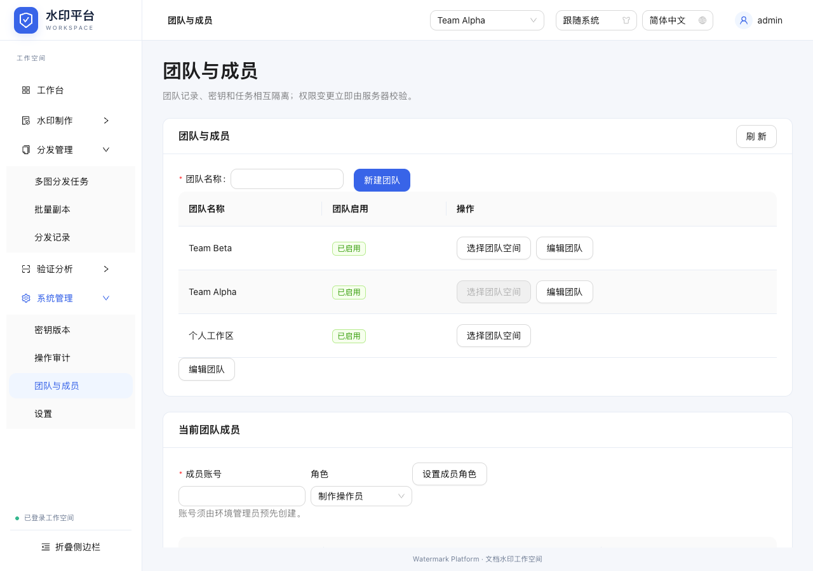
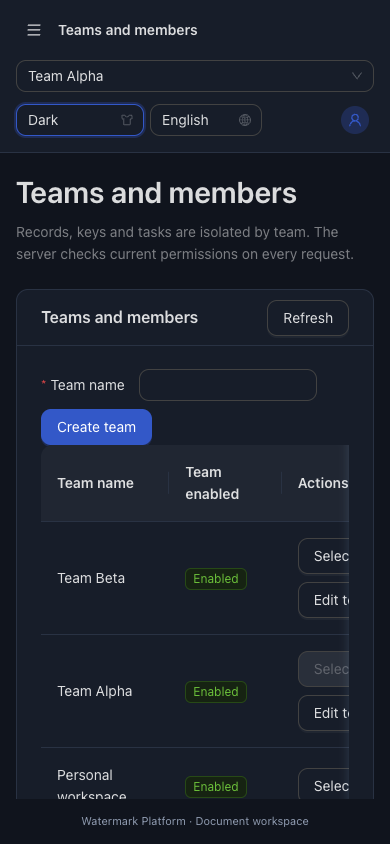

# 批次A验证（完整扩展尚未完成）

2026-10-27，代码533f7f4；基础4cd217d / 引擎838f640。新域、真实API、前端团队与成员的切片完成；B～G仍按完整进度板推进。

- 构建：npm --prefix web/frontend run build通过；AntD vendor既有大包提示保留，没有新增生产依赖。
- Go：go test -race ./...通过；后续JSON必填/撤权预留补充经go test -race ./internal/workspace ./internal/auth ./cmd/server通过；另非环境管理员owner密钥管理正例和不能变全局管理员负例通过；go vet ./...通过。
- 浏览器：PLAYWRIGHT_CHROME_PATH指定本机Chrome，npm --prefix web/frontend run test:e2e最终13项、11个独立服务窗口均通过（workspaces新增1项，原12项保留）。最新用例包括个人/团队及跨账号本机存储命名空间；无强制点击隐藏控件。
- git diff --check通过。测试只用合成账号与fixture副本，不修改生产配置/账号，不部署、不发外部消息。

| AC | 已完成证据 | 尚未完成部分 |
|---|---|---|
| AC-007 | 服务端跨团队密钥/记录拒绝，实际A生成ZIP/B无法登记检出；operator/reviewer/owner正负权限，角色降级与禁用即时生效，旧个人空间拒绝新成员 | 无本批遗留，后续新能力仍需沿用并验证相同隔离 |
| AC-012 | 13项旧/新真实UI，登录/主题/手机/生成/恢复/模板/溯源保持；越权hash回工作台 | 新能力B～F尚未实现 |
| AC-013 | AES-GCM密文/错key/篡改/进程锁/重启/并发冲突/写失败；1MiB/512事件安全撤权预留，必填字段遗漏不隐式撤权；原格式不变 | 通讯录/策略/调查/通知等未来资源生命周期仍须落地 |
| AC-014 | 本批测试、README、CHANGELOG、实际截图和分批main提交 | 全部能力综合验收待G，不可现在标整个目标完成 |

新域上限：256成员账号、32空间（含个人）、16MiB元数据与10万事件；成员账号名ASCII 1～64，密码12～72字节。协作状态绑定环境管理员名称；改环境密码可重启，改名不可静默接管已有数据。元数据加密与旧引擎v2认证记录格式的区别已写README。

