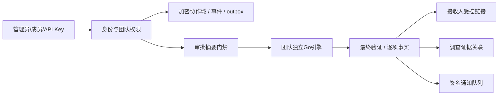

# 完整能力设计与消费者契约

## 边界

新增internal/workspace域承载协作元数据，使用独立workspace-v1.enc（AES-GCM、独立派生密钥、0600、原子rename+fsync、文件与对象限额、进程锁、写失败关闭写入）。已有platform.json/v2不改，不把新成员直接接入旧全局Store。元数据更新、领域事件、通知outbox同一加密提交；原图/成品另走有界临时文件，不进入JSON。

Environment admin保留既有环境配置；新增本地用户以bcrypt保存密码摘要，session记录实际身份。每次请求从workspace检查账号/成员状态和角色，撤销后不信任旧session；机器token有独立摘要、范围、到期、撤销。默认personal空间仅引导admin，旧根API仍仅其可访问。

每团队引擎用独立目录与派生主密钥复用distribution.Store/delivery.Manager，实现已有记录、密钥与任务物理隔离。通过受控Gin子路由适配而非复制处理器：/api/workspace/teams/:team/engine/api/...；上层完成身份/角色/审批校验后以内部context传身份，子路由不接受伪造HTTP身份头。共享全局处理信号量，队列/磁盘/暂存仍有界。禁用团队不接受新写入，已产生事实保留。

## 新域模型

- User：username、bcrypt hash（不返回）、enabled、revision；管理员创建/禁用/重设密码。
- Team：随机id、name、owner/operator/reviewer成员、enabled、revision；personal仅admin。
- Recipient：team/id、recipient_id、name、groups、revision；导入原子验证，组选择转换为分发快照。
- Policy：team/id、版本集合、published版本、内容摘要；发布和回退均事件化。
- Approval：team、请求者、输入/渲染/策略摘要、待审/批准/拒绝/撤回、审批人、原因；执行必须命中批准快照。
- Investigation：team、标题/状态、备注/证据时间线、证据源SHA与服务端验证摘要、不可变来源记录快照；导出不信任客户端检出声明。
- Link：team/任务/接收人、token摘要、密码摘要、截止、限次/已用、撤销、访问事件；返回由服务端按接收人过滤，底层成品过期则失效。
- APIKey / Webhook：仅摘要或加密secret，作用域/team/到期；outbox事件有幂等事件id、签名、尝试/下次时间/终止状态。
- BatchRun：team、输入路径/摘要/模式/参数快照、逐项状态、失败清单、暂存到期；不依赖浏览器假进度。
- Audit：递增sequence、actor、team、action、target、结果/时间；不把完整密码/正文或名单写入事件。

所有修改用revision乐观并发；失败保留旧状态，未知字段/不合法引用拒绝。独立文件新域上限/默认明确写配置与README；不修改旧默认留存。

## API分组

/api/workspace/me，/users（admin），/teams（按成员筛选），/teams/:id/members，/teams/:id/recipients（search/import/export），/policies（versions/publish/rollback），/approvals（request/review/withdraw），/cases（evidence/notes/export），/links（create/revoke/access），/tokens（create/revoke），/webhooks（config/outbox/retry），/operations（snapshot）。公共下载独立/public/delivery/:token，密码走POST body，响应no-store、attachment；不要求携带登录Cookie，不泄露任何其他副本。

团队引擎调用复用api.ts的受控prefix，auth/me/团队管理保持根路由。owner可管理成员/策略/审批/团队密钥；operator可制作分发/提交审批；reviewer只读与验证/审批，操作者不得审批自己。根管理员可管理全环境；所有后端独立判权，隐藏菜单不作为安全边界。

## 处理能力

- PDF使用真实Go PDF解析器按页字典/内容操作，选页/封面/每页模板由服务端验证；输出重新解析，逐页检出签名标识，未选页不添加。新协议与兼容PDF尾注释明确区分。新依赖先核对官方文档及license，再锁版本。
- 混合目录/ZIP：先计划/预检规范路径，拒绝绝对路径/../反斜杠绕过/重复规范名/符号链接/加密/嵌套炸弹；有界逐项解压并验证实际字节。使用随机物理文件名，不以用户路径直接写盘；逻辑相对路径仅ZIP输出。复用Go图像与兼容文档处理，最终逐项提取；失败可修正原件并按失败集重试，清单明确部分成功。
- 参数推荐/实验：独立拷贝同一原图，用本次实测候选（输出编码/可见样式等，不擅自改DCT协议）评估质量、恢复与耗时；不自动应用。扩展旋转/裁剪/叠字与模拟截图，实验而非产品鲁棒性保证。
- 运维统计来自各引擎/批处理/outbox实际状态，按团队/管理员聚合，展示占用与清理故障，不公开原始服务器路径。

## 状态与安全

通知外发采用允许配置的HTTPS、禁止私网/loopback/link-local/元数据地址，解析与连接绑定防DNS重绑定，禁重定向，响应/超时/重试有界；本机测试仅注入测试transport，不能把测试绕过暴露成生产配置。API token独立同源策略与审计，不能通过token突破团队角色或审批。限次下载串行预留/计数，即使客户端断开也不突破次数；密码错误统一响应且限流。

## 兼容与回滚

保留旧环境管理员和根路径；新域单独文件/目录，旧二进制不得访问新团队数据。升级前备份完整数据目录和外部主密钥；回滚必须停止新版后恢复升级前完整备份，不能把跨文件状态混搭。任何发布/迁移真实环境需另行授权。
