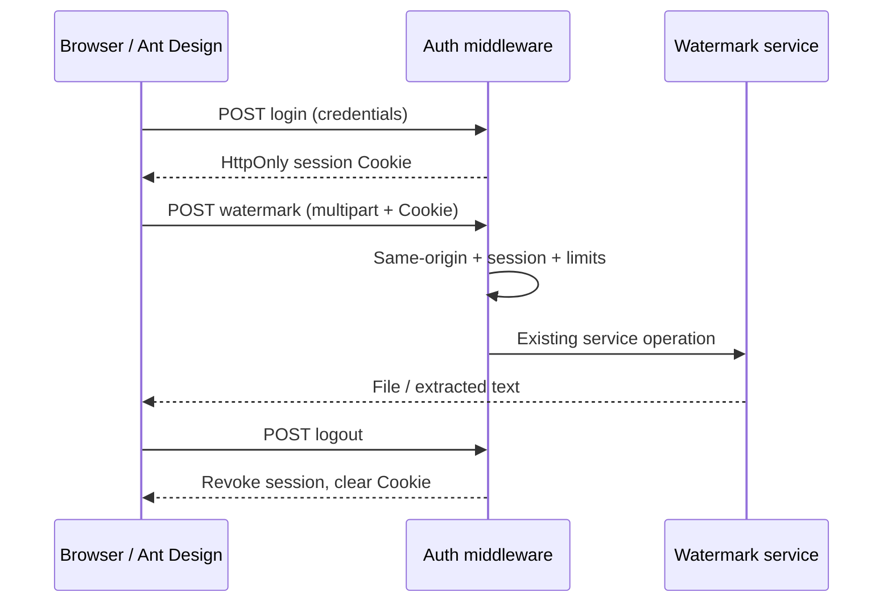

# 平台化技术设计

- 输入：已由用户于 2026-10-26 确认的 requirements.md。
- 分支：main，用户明确要求。状态：实施前设计。

## 边界与界面

web/frontend 使用 React、TypeScript、Vite、Ant Design。Go 提供 web/dist/index.html 及 /assets 静态资源；不依赖运行时 CDN。原有 HTML/CSS/JS 入口退役。构建产物不提交，部署前执行 npm ci 和 npm run build。

组件按 App（会话/主题/语言）、Shell（导航布局）、Login、Dashboard、WatermarkPage、Settings 拆分。主题通过 ConfigProvider 的算法与 token 统一；语言通过词典和 Ant Design locale 统一。登录页同样可设置偏好。桌面侧栏可折叠，手机 Drawer 导航。页面使用 hash 路由，不要求后端 SPA fallback。上传页面保留在组件树中，切主题语言或导航不丢失输入。

工作台展示真实功能入口、支持格式和文件限制，无虚构数据。设置页提供个人显示偏好与当前账户信息。

## 配置与数据

| 对象 | 字段 | 类型/必需/默认 | 归属与验证 |
| --- | --- | --- | --- |
| 环境 | WATERMARK_ADMIN_USER | string，必需 | 服务端，非空 |
| 环境 | WATERMARK_ADMIN_PASSWORD | string，必需 | 服务端，至少 12 字符；不记录凭据 |
| 环境 | WATERMARK_COOKIE_SECURE | bool，可选，false | HTTPS 部署设为 true |
| 环境 | PORT | string，可选，8080 | 服务监听端口 |
| 会话 | token | 32 随机字节 | 服务端仅存 SHA-256 摘要；Cookie 存令牌 |
| 会话 | expiresAt | time，8 小时 | 内存；过期/退出删除；重启失效 |
| 偏好 | theme | light/dark/system，默认 system | localStorage，仅显示设置 |
| 偏好 | language | zh/en，默认 zh | localStorage，不含身份数据 |
| 文件表单 | file/text/showTimestamp | File/string/bool | 页面内存；文本 UTF-8 字节上限 100，文件 50 MB |

认证模块独立在 internal/auth；水印算法与 CLI 不变。会话并发 map 加锁，定期清理在认证请求时执行；限制会话容量。现有限流 map 加锁修复并发访问。

## API 契约与迁移

- GET /api/auth/session：有效会话 200 {user:{username}}；无会话 401 {code:"unauthorized"}；未配置 503 {code:"auth_unconfigured"}。
- POST /api/auth/login：JSON {username,password}，成功 200 同 session，并设置 Path=/、HttpOnly、SameSite=Strict、可配置 Secure Cookie；无效凭据 401；未配置 503；限流 429。
- POST /api/auth/logout：删除服务端会话与 Cookie，204；无会话同样可执行。
- /api/add-watermark、/api/extract-watermark、/api/supported-types 保留路径、字段和成功响应，但需 Cookie，否则 401。原有调用者先登录并使用 Cookie jar；CLI 不受影响。
- 写请求拒绝非同源 Origin / Sec-Fetch-Site: cross-site；移除 wildcard credential CORS。请求 JSON 登录限长，文件请求体限长（50 MB + multipart 开销）。API 返回 Cache-Control: no-store。
- 后端文件错误保留原有 error；前端英语模式显示对应通用错误和恢复建议，不向页面插入 HTML。

## 生命周期、失败与可观察性

首次加载探测会话，显示 Spin；网络错误显示可重试面板，不伪装成退出。错误凭据显示 Alert。会话失效转登录并提示重新登录，页面草稿在当前应用生命周期内保留。退出清除页面草稿和下载 URL。文件结果以 React 文本节点渲染，下载 URL 在更换结果/卸载时释放。服务重启使会话失效。超过容量会话拒绝创建。文件请求不自动重试，按钮处理中禁用。

不记录密码或水印文本。沿用请求状态与耗时日志。API 错误统一由前端适配器处理；网络失败与 HTTP 401/413/429/503 可辨。

## 验证与回滚

Go 单元/HTTP 测试覆盖缺配置、错误凭据、Cookie 属性、过期、退出撤销、跨源拒绝、并发鉴权；真实服务 PNG 添加/提取往返验证。前端类型检查和生产构建；浏览器验证登录、侧栏、偏好、表单、移动端。Go race 测试验证共享状态。部署必须一起发布前端构建与后端；回滚本次功能提交恢复匿名 API，因此生产回滚需评估访问策略。

参考：[Ant Design 主题](https://ant.design/docs/react/customize-theme/)、[ConfigProvider](https://ant.design/components/config-provider)、[Vite 构建](https://vite.dev/guide/build)。
