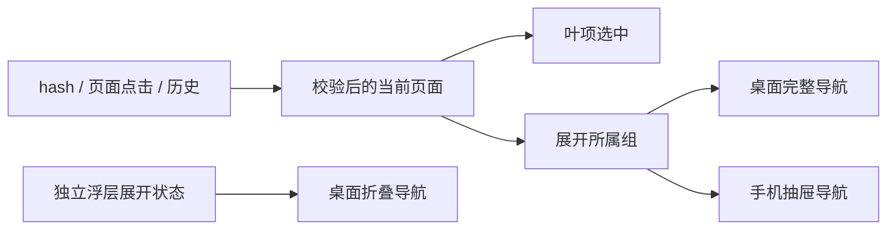

# 二级导航设计

共用 navigation.ts 定义页面与父组关系，SidebarNav 使用 Ant Design Menu 的 items.children 渲染。桌面 Sider 与移动 Drawer 复用组件和分组，不复制路由逻辑。保持现有页面挂载策略、hash 路由及 API 不变。

Shell 保存完整导航的 openGroups 与折叠浮层的 popupGroups。页面变化时把当前父组加入 openGroups、清空浮层；手动开关不触发强制展开。桌面展开时补充当前父组。手机始终 inlineCollapsed=false，避免继承桌面收起状态。无新增持久化。

所有页面键通过 isPage 校验；父分组只展开不导航。叶节点选中 page；分组保留 AntD 键盘、选中父级与浮层交互。分组带图标、叶项用文字，英文长标签沿用原文字及原生 title。顶层四组与工作台，最多两级。使用现有主题 token 和双语字典。

导航容器内部滚动，底部状态与折叠按钮维持现有固定位置。加载/失败/权限状态继续由现有页面处理，导航不引入异步接口。

风险：原有浏览器用例直接点击一级叶项，需要改为先展开父组；不能用强制点击或直接 hash 替代真实菜单导航。浮层状态与完整导航分离，防止折叠切换污染手动展开状态。
