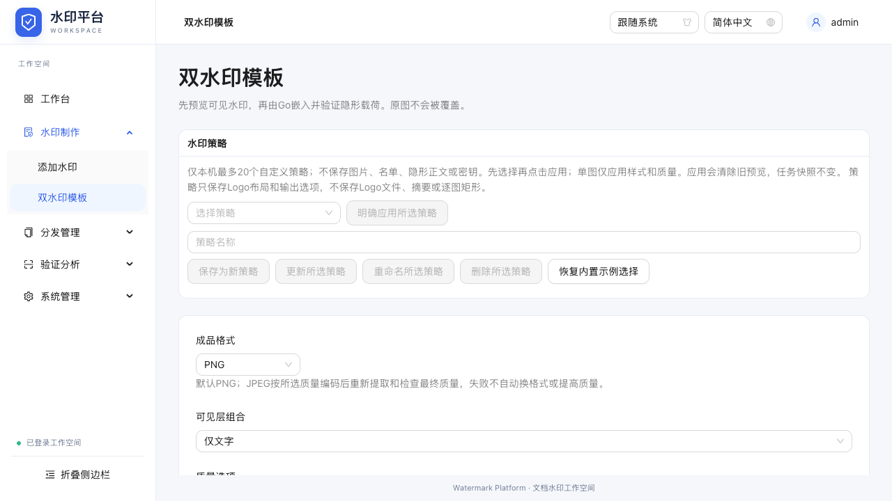
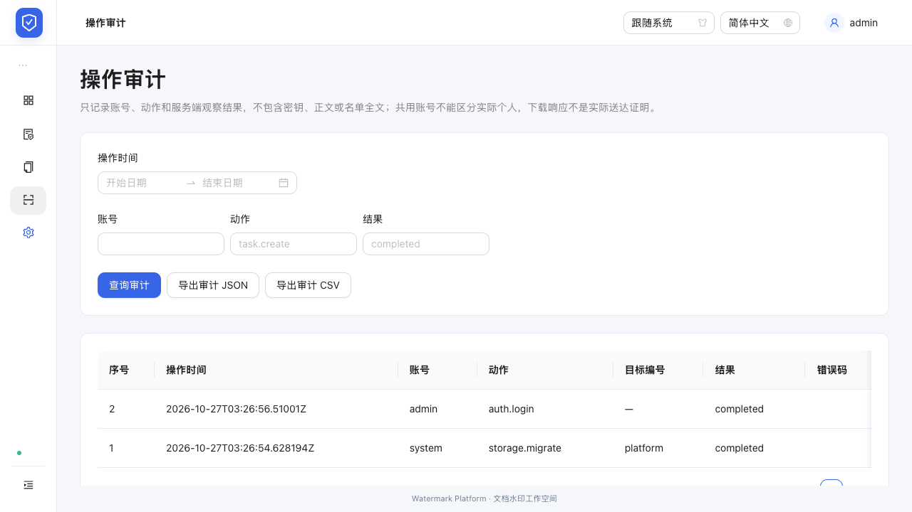
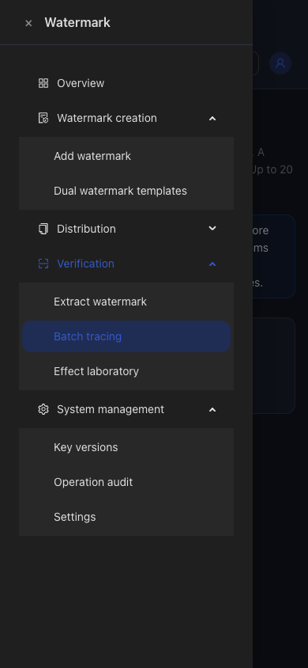

# 二级侧边栏验证

2026-10-27，本机 Chrome，专用 :18080 测试服务，合成测试数据。代码提交 f4e1cc5。

## 自动检查

- `npm --prefix web/frontend run build`：TypeScript/Vite 通过。AntD vendor 分包仍有既有大包提示；本轮未引入依赖。
- `PLAYWRIGHT_CHROME_PATH='/Applications/Google Chrome.app/Contents/MacOS/Google Chrome' npm --prefix web/frontend run test:e2e`：9个独立服务窗口，10项用例全部通过，退出0。
- `git diff --check`：通过。
- 后端/API/数据格式未变，本轮不重复执行无关 Go 单元套件；端到端使用真实 Go 本地服务完成业务往返。

| 验收点 | 证据 |
|---|---|
| 十二入口与四组映射 | navigation.spec：首页5个顶层、逐项点击11个子项及独立工作台；无重复叶项 |
| 路由同步 | navigation.spec：#dual直链/刷新、前进后退、品牌回工作台、工作台开始添加、账号设置；均断言选中 |
| 手动与键盘 | 当前父组关闭/重开、Enter键开关通过 |
| 折叠 | 悬停浮层、子项真实跳转、浮层消失、展开后恢复正确当前组 |
| 响应式 | 桌面收起后390px抽屉仍完整二级；点击关闭、重开选中正确；480px短屏导航内部滚动、底部按钮在视口内 |
| 语言/主题 | 中文桌面、英文手机暗色；无页面横向溢出，英文叶项完整显示 |
| 原有业务 | platform 2项；distribution/workbench/jobs/jobs-cancel/trace-quality/logo-exclusion/jpeg-jobs 各1项，全通过 |

专项初次测试捕获 AntD 默认 hover 延迟导致选中后浮层重新打开；公开参数 subMenuOpenDelay=0 修复后，专项及全套均通过。另调整测试在抽屉关闭后等待其隐藏，避免焦点恢复干扰语言选择。未采用强制点击或通过hash替代菜单业务步骤。

## 视觉检查

已打开实际截图确认：桌面二级间距与选中、底部到底；折叠浮层；手机英文暗色下完整标签及独立展开。所有截图均为本地合成数据。

## 边界

展开状态仅在当前会话保存；重新加载默认只展开当前页面父组。没有新增后台权限、接口、部署或数据迁移。
