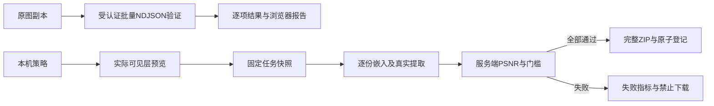

# 批量溯源、策略及质量：技术设计

输入：[Confirmed需求](requirements.md)。本文件是实施契约，不是已完成声明。沿用main交付，标准库，无新增生产依赖。

## 边界及流转

- internal/quality负责Policy/Metric/Summary和纯像素度量，不依赖服务、持久域或浏览器。
- distribution保存可选quality_policy及各JobCopy质量结果，delivery计算，不信任客户端分数。旧任务缺字段表示未记录，不追算。
- server负责批量文件边界、逐项验证、认证/审计及单图质量响应；复用已有verifyWorkbench/Lookup。浏览器负责本机策略、预览、进度、转义报告与质量展示。

## 数据契约

| 对象/字段 | 类型、默认与所有权 | 校验/兼容 |
| --- | --- | --- |
| Policy.minimum_psnr_db | 可选number，省略表示只展示 | 有限20～60；服务端复核；未知字段拒绝 |
| Metric.status / psnr_db | finite及number、infinite、unavailable | 不以null同时表示无限和不可比较 |
| Summary | width,height,capacity_bytes,verified,embedding,visible?,accepted | embedding参考实际嵌入输入；visible参考原始解码图；无分数臆造 |
| Job.quality_policy | 可选Policy；新Web请求传{} | 纳入指纹，固定不随本机策略变化；旧请求可不传 |
| JobCopy.quality | 可选Summary | 逐份计算，失败份保留实际指标；重试清空上次结果；终态与任务一起持久化 |
| 本机PolicyPreset | id,name,mode,template,style,quality | 版本1、最多20自定义；3内置从代码恢复；精确字段白名单，不存隐形载荷/图/名单/版本密钥 |

Metric为RGB MSE的10log10(255²/MSE)，相同像素是infinite，不同/空尺寸unavailable；双水印不能把可见层变化归因于隐形嵌入。实际verified来自提取一致性。显式门槛仅控制embedding；低于/无法计算为quality_failed，不改变算法。容量沿用Go v1短文本能力。

## API及状态

新增POST /api/workbench/trace-batch：multipart files多值，最多20，每份50MiB、总128MiB，请求129MiB硬界，在公共单图51MiB中间件之前注册。先取得共享blindSlots，再解析暂存，不增加并行处理；请求结束移除multipart临时文件。先完成认证/配置/数量体积校验，再响应application/x-ndjson：begin含随机batch_id与total，item含1起始index、脱敏不入审计的显示name、duplicate_of?和verificationReport或error，end含completed/partial/failed。每条flush展示真实进度。系统错误以fatal帧停止，不记为not_found；取消关闭连接，当前编解码/提取结束后停止，不启动后续项。

浏览器状态idle→uploading→running→completed/partial/failed/cancelled。用同一AbortController防重入；已收item保持不变，未收项显式not_confirmed（未收到结果，不能因没有响应而断言服务器从未处理），网络/认证是error。离页/重新选文件会清理本次结果，beforeunload提示未保存；不保存图片/报告到服务器。报告含batch_id、观察时间、选定总数、完成数、终态及全部输入项，不把部分批次当全部成功。

现有POST /api/workbench/dual保持PNG响应；新增可选quality_policy表单JSON与original原始文件，以X-Watermark-Quality返回安全有界JSON摘要。门槛失败422 JSON含code与quality。workbench注册改为自带按路由上限的body保护（dual101MiB、其他51MiB），不叠加公共单图上限；原始图与渲染图每份仍50MiB。旧调用不传original则visible未记录，原PNG协议兼容。

POST /api/jobs/preview-plan及/jobs新增可选quality_policy，严格解码；前端Plan/恢复比较包含它。delivery逐份同时核对原图/渲染图、实际嵌入并测量，持久域记volatile度量至下次原子提交/终态，ZIP manifest新增指标列。失败不发布完整包，已完成的别的登记不动。

审计新增trace.batch，目标仅随机batch_id、终态与受控错误码，不存名字/载荷/名单。服务端读取/验证审计失败依旧告警，关键任务写使用现有原子审计。批量流开始后的故障设置audit_outcome/audit_code供现有中间件记录，不依赖200外层判断语义成功。

## UI及共享组件

独立批量溯源导航、响应式Table/展开详情、JSON/CSV/HTML导出。共享QualityFields/QualitySummary、PolicyControls（选中与明确应用、保存、更新、改名、删除、恢复内置），在JobsPage应用全部策略；DualPage只应用样式与quality，不填隐形正文。旧样式模板原存储不迁移/删除。共享中英文本；所有输入变更使预览失效，持久任务详情独立展示。

## 恢复、资源与兼容

批量请求重试需显式重新发起，不自动重复读取；已完成结果本机可导出。无新长期存储或单独后台队列。批量磁盘暂存最多2×129MiB与既有任务预算分别明确，取得处理槽后解析，服务WriteTimeout须适配真实多文件处理。质量策略字段可选，v2格式不升版本；升级前完整备份，旧程序可能忽略新质量字段不再执行门槛，因此不得用旧程序重试新质量任务，回滚恢复升级前备份。失败指标不是可信签章，不代表人眼质量或抗几何能力。

无未决产品问题。F5需覆盖流式断连、资源释放、真实混合验证、报告安全、策略存储失败、手算像素与门槛边界、真实6副本全部质量、低门槛失败整包、旧数据重启和原有浏览器回归。
