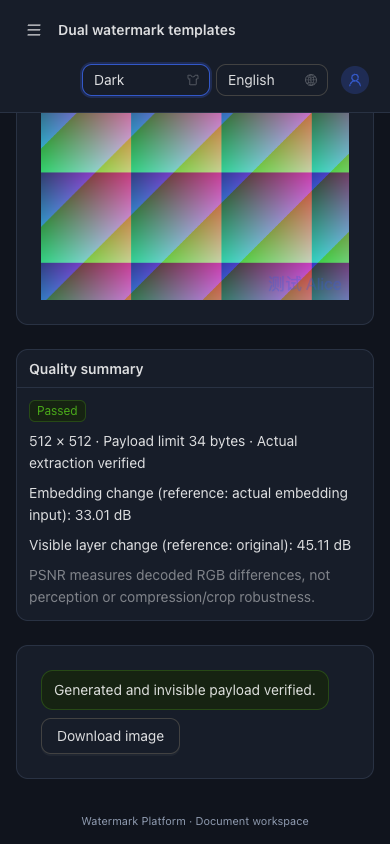
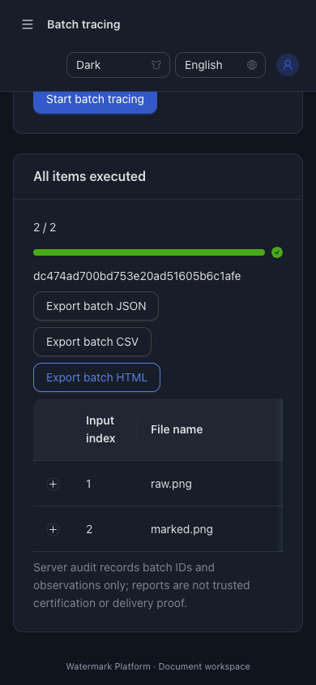

# 批量溯源、策略预设与质量：验收记录

日期：2026-10-27（Asia/Shanghai）。输入：[已确认需求](requirements.md)，契约：[设计](design.md)、[实现计划](implementation-plan.md)。本记录用于本地源码交付，不代表生产部署。

## 检查命令

```sh
go test -race ./...
go vet ./...
npm --prefix web/frontend run build
PLAYWRIGHT_CHROME_PATH='/Applications/Google Chrome.app/Contents/MacOS/Google Chrome' npm --prefix web/frontend run test:e2e
node web/frontend/scripts/restart-smoke.mjs
```

Go全量race/vet与生产构建通过，后续聚焦检查补齐默认策略幂等、实际编码头像素、文件限制精确边界与忙槽。浏览器原有6项流程加新增策略/批量溯源/质量1项，按6套独立服务运行；最终整套7项全部通过（平台2项，其余每套1项），结果记录于workflow.md。脚本使用隔离临时数据和公开测试配置，不连接部署环境。

真实进程重启脚本通过：成品跨重启保持同一摘要，实际TTL到期删除但登记保留，SIGKILL后原任务/副本ID恢复重试、旧单图幂等ZIP、轮换、错误主密钥拒绝、运行临时文件清理及原图摘要不变。质量矩阵测试额外证明新质量结果跨重新打开v2库/执行器保留。

生产构建有Ant Design约1114kB（gzip约346kB）的大包提示；构建成功，未抬高阈值隐藏警告。没有新增Go/npm生产依赖。

## 需求与验收映射

| 验收 | 要求 | 直接证据与范围 |
| --- | --- | --- |
| AC-001 | REQ-001～003 | TestTraceBatchAndDualQualityHTTP真实生成已登记/有效未登记图片，与无水印、损坏、重复图片混合请求，逐行核对状态、摘要与正确Copy.ID。浏览器实际同名不同内容/重复内容显示，下载汇总验证。原始测试PNG未被改写，delivery另检查源文件摘要。 |
| AC-002 | REQ-001/002/004/011 | TestTraceFileLimits核对20/21份、50MiB单份及128MiB总量的相等和+1边界；真实HTTP21份拒绝、修改有效PNG头至超800万像素在解码前变为该项错误。实际取消writer在首项flush时取消，只有首项，没有伪完整end且处理槽释放。浏览器上传阶段取消保留未确认项；JSON/CSV/HTML范围、公式前缀和脚本转义实际检查。系统异常不归阴性，断流归失败。未以生成129MiB请求证明所有传输性能，硬上限由MaxBytesReader执行。 |
| AC-003 | REQ-005～007 | 新浏览器流程保存/更新/改名/应用/删除、刷新恢复阈值；3内置示例明确应用。用实际存储20项证明第21次失败仍保留原20项；损坏内容和QuotaExceeded后不显示成功，可显式新建覆盖损坏列表。检查存储仅含id/name/mode/template/style/quality，旧样式存储不迁移，原工作台模板回归保留。 |
| AC-004 | REQ-008/009 | internal/quality/TestMetricsAndThresholds以1像素RGB差10手算PSNR，覆盖阈值上下/等于、无限/不可比较、越界/NaN/Inf。HTTP实际嵌入：默认PNG成功带质量头/原图可见指标∞，60dB返回422和真实失败摘要；浏览器实际可见层文字使两种参考指标分别展示，默认通过/门槛拒绝均实跑。 |
| AC-005 | REQ-008～010 | delivery/TestQualityMatrixAndGate真实2图×3人独立生成、逐份提取、6份质量及清单JSON列；重新打开库仍有指标。60dB真实失败无归档/部分包，失败份有实际质量，重传重试保留ID/时间/60dB快照；确定性调用周期清理保留新上传输入，并验证15分钟过期/重启清理及令牌换代；调用者修改变量不影响已固定阈值。jobs浏览器实际6张可见文字PNG均验证，断言embedding/visible为finite且逐份accepted/verified。 |
| AC-006 | REQ-006/010～012 | TestQualityPolicyFingerprintAndOldJobCompatibility证明旧v2无质量任务可读/完成、不虚构指标，旧指纹原样保持，省略策略和{}幂等一致，修改阈值同请求冲突，外部修改不改变快照。原密钥轮换/停用/单图重生成/固定算法/迁移测试保留并全量回归；重启冒烟亦覆盖旧图。 |
| AC-007 | REQ-011/012 | 新HTTP真实未登录401/跨站403，满处理槽429、取消无临时目录/槽泄漏；审计含trace.batch取消记录且无文件名/接收人/正文。审计失败/原子关键写/降级保护沿用既有全量HTTP与域测试；读取类批量审计依旧受统一中间件控制，业务写仍原子审计。 |
| AC-008 | REQ-012 | Go race/vet、构建、隔离真实API、7项浏览器流程与重启检查；新增单图质量与批量溯源均在英文/390px深色实跑、无页面横向溢出及合成数据截图。README/API/升级回滚、日期CHANGELOG、此记录及workflow保持同步；最终以远端main=HEAD、工作区干净交付。 |

## 实际截图

以下为实际测试截图，全部使用合成图片及公开测试身份，不包含真实素材或密钥。






## 已知边界

- 临时批量结果仅当前页面；离页前自行导出，报告不是可信时间/鉴定/实际送达证明。无收到的结果标为未确认执行，不能推断服务端未处理或未检出。
- 逐项失败与批次失败分开，取消只能在单次编解码/提取步骤结束后释放资源；无后台永久调查库。
- PSNR对解码RGB，门槛比较未舍入值；它不证明视觉感受或抗压缩、缩放、裁剪、拍屏。字体仍依赖本机，必须检查实际预览。
- v2新增可选字段，旧记录显示未记录。旧二进制忽略新质量门槛，不能用其重试质量策略任务；升级前备份目录及主密钥，回滚恢复升级前完整备份。
- 旧Office/PDF外部样本缺失的测试仍按原条件跳过；本轮不宣称重新验证所有办公软件。
- 测试中较早失败分别是输入数字36与Ant Design格式36.0、取消路由被重复处理、加载图标影响可访问名称，以及旧jobs测试未等待登录完成便直接请求。还定位了真实的重试输入清理竞争，已修复并补确定性生命周期检查；其他问题修复对应测试同步、滚动定位或稳定aria-label；最终只以修复后的实际检查结果交付。
