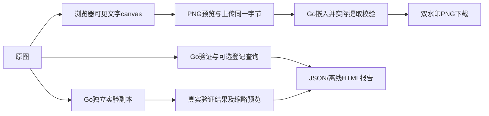

# 水印工作流优化设计

输入：requirements.md已确认。沿用main交付，新增工作流，不变更v1协议或分发持久格式。

## 边界与数据流

- internal/workbench：标准库实验变换、PSNR、预览；只接收解码图片/文本/密钥，独立于Gin及持久存储。
- cmd/server/workbench.go：复用认证/同源/限流、两处理槽、临时目录；当前管理密钥或单环境密钥；不创建分发记录。
- 前端：LabPage、DualPage、共享报告导出/验证组件、canvas模板模块；主题/语言/响应式复用Shell。
- 中文字体使用浏览器系统字体栈，渲染同一PNG预览并上传，避免服务端另起字体造成不同结果；不可用字形尽可能预检并允许用户检查预览，明确系统字体差异，预览必经。

## API（新增，均要求登录与同源）

| 路径 | 请求 | 成功响应 |
| --- | --- | --- |
| POST /api/workbench/lab | multipart file原图、watermark | JSON实验报告，10行（8变换+2负例），缩略预览；无持久记录 |
| POST /api/workbench/dual | multipart file已预览可见图、watermark | PNG；实际提取文本及时间校验成功才返回 |
| POST /api/workbench/verify | multipart file、可选key_id | JSON验证报告；未检出/签名失败是200内的明确状态，配置/网络/输入异常为非200 |

原图和渲染图均受50MiB/800万像素限制；实验沿用34字节及容量限制。全局最多2个处理任务；实验90秒上下文上限，各独立变换间检查取消；每次请求完成删除临时图。没有服务端任务对象或历史记录。取消后UI立即恢复并忽略迟到结果；服务端完成当前不可中断的单次编解码/嵌入后退出。

## 结果字段（新增，schema_version=1）

| 对象/字段 | 类型/必选 | 默认及校验/所有者 |
| --- | --- | --- |
| VerifyReport.kind/schema_version | string/int，必选 | verification/1，服务端 |
| source_sha256,width,height | string/int/int，必选 | 对实际上传字节哈希及解码尺寸 |
| tested_at,elapsed_ms,algorithm | UTC/string、number、string，必选 | 服务端观察时间、实际耗时、go-dct-v1 |
| status,error_code | string/string可选 | registered/unregistered/not_found/invalid；未知不得称无水印 |
| result,key_id,record | object/string/object可选 | 仅真实验证通过后返回；记录来自现有Lookup，单环境不伪造版本ID |
| LabReport.cases | array，必选 | case_id、parameters、width/height、recovered、error_code、elapsed_ms、psnr_db可空、output_sha256、preview可选 |
| LabReport.baseline_ok,original_intact | bool，必选 | 基线必须正确恢复；请求源文件摘要前后比对 |
| Template | browser-local v1 | name<=40字符、样式及位置/字号/颜色/透明度/角度；最多20个，不含图片/输入文字 |

实验：png、jpeg95/85/75、nearest-neighbor缩放75%/50%、中心裁剪保留90%宽高、顺时针90度旋转；每份直接来自基线。两个负例各验证未标记原图及随机错误密钥；负例与预期不一致明确标记，不作为真实保护结论。同尺寸PSNR相对原始解码RGB；完全相同用null与说明，不用100假装真实无限值。预览为最多640px的JPEG缩略图，不是用于验证的原始输出；验证在完整变换输出上执行。

## 双水印与模板

先渲染可见层再嵌入盲水印；隐形文本独立填写。canvas按原像素尺寸处理，单处位置左上/右上/中央/左下/右下，平铺支持角度-90～90、字号12～96、alpha0.05～1、RGB色。文字最多80字符且限制边界，不自动裁掉；多行不支持并明确提示。下载按钮只在显式预览后启用，输入/样式改变立即作废旧预览与结果。字形检查与用户预览都不可替代Go的实际提取验证。

模板只保存样式，localStorage使用独立v1键，读取验证结构，损坏时可恢复；存储满/禁用明确提示。图片、文字、密钥、报告不自动长期保存。选择模板、删除模板、修改参数均清除旧结果。

## 报告、错误与隐私

JSON保存服务端报告。HTML为离线自包含文档，无脚本/外部资源，通过安全转义显示所有输入文本，内置打印样式并解释边界。保留JSON字段名以便对照；UI标题及操作中英对应。单图Go提取及图片溯源均挂共享报告验证导出入口，使用当前文件/密钥进行独立验证，明确任务状态；合法未登记与失败分别标记，服务异常不会伪造验证结果。legacy不伪装成Go报告。

日志只记路径/状态/耗时。认证401会退出，资源429可重试，非法图片422/配置503沿用现有错误码。报告不是签章或法律鉴定；登记不等于实际泄露者，不证明整图完整性。

## 兼容、发布与风险

无新依赖、无数据库迁移、无自动部署。未配管理库时可用旧环境密钥，管理库不可用时不静默降级。旧API/CLI/固定夹具及批次重生成保持。回滚代码保留既有持久目录。已知风险：系统字体不同；测试图不代表普适恢复率；大图处理需有界并明确取消粒度。
